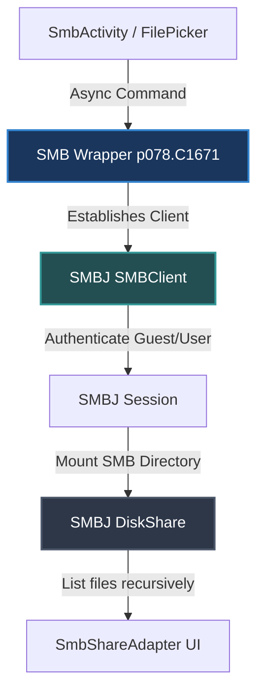
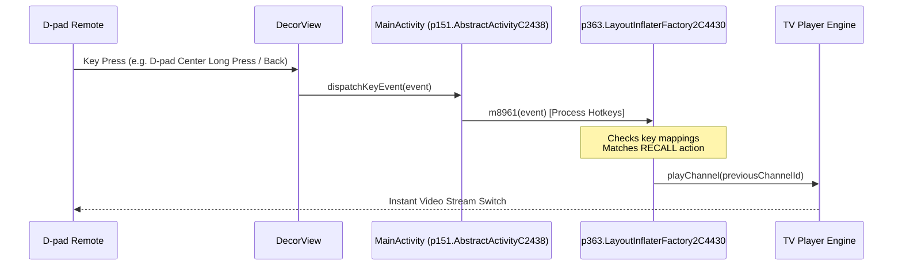

# TiViMate Advanced Features — Deep Technical Analysis

This document provides a comprehensive architectural breakdown of **TiViMate’s** advanced features: its modern Samba/SMB implementation, the unified local and network folder browsers, the D-pad channel recall and history system, and the liquid-smooth Multiview (Multi Mode) engine.

---

## 1. SAMBA/SMB & NETWORK SHARE ARCHITECTURE

### The Shift to SMBJ (SMBv2/v3 support)
Unlike older Android IPTV applications that rely on the legacy `jcifs` library (which is locked to the insecure and deprecated SMBv1 protocol), TiViMate implements network share access using **SMBJ** (`com.hierynomus.smbj`), a modern, pure Java SMB2/3 client.



### Key SMB classes in TiViMate (`p078` Package)
* **`C1671.java`**: The primary wrapper for active SMB session directory queries.
  * `m4556(String path)`: Recursively lists directory contents using an SMB query pattern (`*`) and stores results in a memory list.
  * `m4558(String path, Set flags, ...)`: Creates or opens directories/files on the SMB share, returning a polymorphic representation: `C1677` for remote directories or `C1673` for remote files.
  * `m4559(String path)`: Performs a quick network query to check if a backup file or recording directory exists on the share without downloading metadata.
* **`AbstractC1679.java`**: Handles connection parameters, timeouts, and closing sockets safely.
  * Allocates a connection pool (`C3304` and `C3602`) and tracks keep-alive durations.
  * Configures connection timeouts using standard SMB properties, handling exceptions like `SMBApiException` (wrapped from SMBJ's `com.hierynomus.mssmb2.SMBApiException`).
  * Enforces an automated retry/busy timeout cycle and graceful release of connection tokens to prevent resource leaks on host servers.

---

## 2. UNIFIED FOLDER BROWSER (LOCAL & REMOTE)

TiViMate implements a unified directory navigation paradigm through `FilePickerActivity` and `SmbActivity`, sharing layout components and adapter logic.

```
[ Unified File/Directory Model ]
               │
      ┌────────┴────────┐
      ▼                 ▼
[ Local Disk File ]   [ Remote SMB File ]
  java.io.File          p078.C1673 (File)
  DocumentFile (SAF)    p078.C1677 (Directory)
```

### The Android TV Focus & D-pad UX
To make folder browsing functional on Android TV devices with a remote control, TiViMate uses a custom view selection system:
1. **D-pad-Optimized Row Layouts**: Every item in the directory list (`focusable_row_item.xml`) is configured with `android:focusable="true"` and `android:clickable="true"`.
2. **Custom Focus Highlight**: Custom focus listeners detect D-pad shifts, triggering subtle color changes (e.g., changing background tint to slate or blue) and running minor scale-up animations.
3. **Automatic Centering**: The folder list is bound inside a Leanback-based `VerticalGridView` which automatically adjusts its scroll offset to keep the currently selected directory item vertically centered on screen.

### Scoped Storage & Local Fallbacks
On Android 11+ (API 30+), standard file operations are heavily restricted. TiViMate adapts to these constraints through a hybrid local folder browser:
* **Scoped Storage (SAF)**: Utilizes `Intent.ACTION_OPEN_DOCUMENT_TREE` to query external storage permissions.
* **Legacy Emulation**: For legacy devices or storage structures, it falls back to standard `java.io.File` listing, using high-performance background executors to prevent ANRs (App Not Responding) when reading large directory trees.

---

## 3. D-PAD CHANNEL RECALL & HISTORY SYSTEM

Tapping a D-pad button to switch to the previously playing channel (Recall) or navigating a horizontal strip of "Recent Channels" is a signature TiViMate navigation pattern.

### Key Event Interception Flow
TiViMate captures and overrides hardware key presses at the Window Callback layer to enable smooth, zero-latency D-pad actions:



1. **`dispatchKeyEvent` Override**:
   `AbstractActivityC2438` intercepts all hardware keyboard and D-pad events before they propagate to standard view components.
2. **Key Dispatching (`LayoutInflaterFactory2C4430`)**:
   Processes key events dynamically. If a user presses the assigned Recall hotkey (or long-presses D-pad Center), the dispatcher cancels standard event consumption and triggers a direct player channel-change call.

### History/Recent Channels Implementation
The app implements a robust double-buffered memory queue to record channel states:
* **The "Recent Channels" Queue**: Held in an in-memory `LinkedHashMap` or bounded `ArrayDeque` inside a singleton manager class.
* **EPG Integration**: Each item in the history holds a reference to the `channel_id`, the time it was played, and a snapshot of the active EPG program title.
* **The Surf Filter (Delay Interval)**:
  > `"Delay before adding to recent channels, sec"` (e.g., `u_res_0x7f13034e`)
  To prevent quick channel-surfing from cluttering the user's history, TiViMate utilizes a configurable timer (typically defaulting to 5 seconds). A channel is only committed to the history database or memory queue once the user has continuously streamed it past this threshold.

---

## 4. MULTIVIEW (MULTI MODE) ARCHITECTURE

TiViMate's Multiview engine allows users to display 2, 3, 4, or up to 9 channels simultaneously on a single screen.

```
┌───────────────────────────────────────────────┐
│              Custom Multiview Grid            │
│  ┌───────────────────────┬─────────────────┐  │
│  │   Player 1 (Active)   │    Player 2     │  │
│  │   - Audio: YES        │    - Audio: NO  │  │
│  │   - Decoder: H.264 HW │    - Decoder: HW│  │
│  ├───────────────────────┼─────────────────┤  │
│  │   Player 3            │    Player 4     │  │
│  │   - Audio: NO         │    - Audio: NO  │  │
│  │   - Decoder: HW       │    - Decoder: HW│  │
│  └───────────────────────┴─────────────────┘  │
└───────────────────────────────────────────────┘
```

### Technical Implementation Steps
1. **Multi-Player Instances**:
   Instead of a single player instance, the app instantiates an array of independent ExoPlayer instances (`androidx.media3.exoplayer.ExoPlayer`).
2. **Dynamic SurfaceView Grid Layout**:
   A custom layout container (extending `ViewGroup`) manages the exact screen coordinates. It dynamically computes screen splits based on the number of active feeds:
   * **2 Screens**: Split screen (50% width each or picture-in-picture).
   * **4 Screens**: Standard quad-grid layout (2x2).
   * **3/5 Screens**: Large master screen on the left, smaller helper screens stacked on the right.
3. **Decoupled Audio Focus**:
   Each ExoPlayer instance is managed under a unified audio controller. Only **one** player is granted active audio rendering at a time. The remaining instances are muted (`setVolume(0f)`) to prevent overlapping audio chaos and to save CPU cycles by bypassing audio decoding.

### Hardware Decoder Limits & Mitigations
Decoding multiple live HD video streams concurrently is highly hardware-intensive. Standard Android TV chips have strict hardware decoder limitations. TiViMate manages these constraints gracefully:
* **Decoder Limit Detection**: If the hardware video decoder (e.g., MediaCodec) runs out of secure H.264/H.265 resources, it throws a standard ExoPlayer `ExoPlaybackException` with code `DECODER_INIT_FAILED`.
* **Graceful Degradation**: When a codec limit is hit, TiViMate catches the exception, displays a descriptive notification, and can automatically fall back to software-based rendering (`FFmpeg` audio/video extension decoders) or disable the newest screen.
* **EPG Sync**: The EPG grid stays synchronized behind the scenes so the user can easily swap, close, or add streams dynamically using simplified D-pad actions.

---

## 5. REPLICATING THESE ADVANCED PARADIGMS IN PUREFUSIONIPTV

To bring these features to **PureFusionIPTV**, structure your implementation around these unified building blocks:

### SMB & File Selection
* Use the **SMBJ** library rather than JCIFS.
* Keep all SMB calls off the main UI thread by using Kotlin Coroutines (`withContext(Dispatchers.IO)`).
* Implement a polymorphic data model:
  ```kotlin
  sealed class FileItem {
      data class Local(val file: File) : FileItem()
      data class RemoteSmb(val smbFile: DiskShareFile) : FileItem()
  }
  ```

### D-Pad Recall & Surf Delay
* In your activity’s `onKeyDown` or `dispatchKeyEvent`, intercept D-pad clicks:
  ```kotlin
  override fun dispatchKeyEvent(event: KeyEvent): Boolean {
      if (event.action == KeyEvent.ACTION_DOWN) {
          when (event.keyCode) {
              KeyEvent.KEYCODE_MEDIA_PREVIOUS, KeyEvent.KEYCODE_LAST_CHANNEL -> {
                  channelHistoryManager.triggerRecall()
                  return true
              }
          }
      }
      return super.dispatchKeyEvent(event)
  }
  ```
* Use a coroutine-based delay before committing played channels to the history:
  ```kotlin
  fun onChannelSelected(channelId: Long) {
      surfJob?.cancel()
      surfJob = CoroutineScope(Dispatchers.Main).launch {
          delay(5000) // 5-second surfing delay filter
          historyRepository.addToHistory(channelId)
      }
  }
  ```

### Multiview Engine
* Implement a layout grid container managing custom `PlayerView` instances.
* Ensure only the selected view has audio focus:
  ```kotlin
  fun selectActiveWindow(playerView: CustomPlayerView) {
      allPlayers.forEach { it.setVolume(0f) }
      playerView.player.setVolume(1.0f)
      activePlayer = playerView.player
  }
  ```
