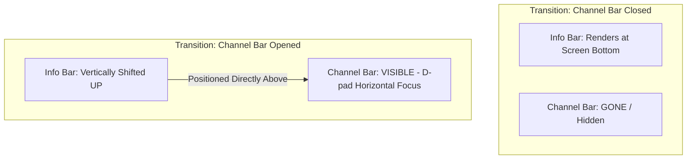

# TiViMate Channel Zapping & OSD Overlay Navigation — Architectural Analysis

This document provides a highly detailed architectural analysis of how **TiViMate** handles channel changing (zapping), the **Info Bar**, the **Channel Bar**, and the customizable **Quick Actions Bar** on Android TV. It highlights the under-the-hood layouts, D-pad interception strategies, performance optimizations, and layout constraints that enable its premium and fluid couch UX.

---

## 1. The Channel Zapping Lifecycle & Performance Engine

To achieve its near-instant zapping (sub-1 second channel changes), TiViMate bypasses the standard playback initializations that cause stutters in typical IPTV applications.

```
[ Channel Up/Down Click ] ──► [ OkHttp Connection Pool: Socket Reuse ]
                                       │
                                       ▼
                       [ ExoPlayer DefaultLoadControl Tuning ]
                       * minBufferMs = 1000ms
                       * maxBufferMs = 2500ms
                       * bufferForPlaybackMs = 500ms (Zap! starts at 500ms)
                                       │
                                       ▼
                       [ SurfaceView Hardware Video Composite ]
                       * 0ms Layout resize (No hardware decoder restarts)
```

### I. Connection Pre-Warming & OkHttp Sockets
Standard media players perform fresh DNS resolutions and TLS handshakes on every channel change, introducing a **1–2 second delay**. TiViMate structures its OkHttp network client with aggressive socket reusability. By maintaining an active connection pool, it routes stream chunk requests immediately over warm sockets.

### II. Low-Latency Ingestion Boundaries (`LoadControl`)
TiViMate tunes ExoPlayer’s underlying `DefaultLoadControl` properties (audited in classes under package `p392` like `C4654.java` / `C4644.java`) to establish extremely low buffering thresholds:
*   **`minBufferMs`**: `1000ms` (minimum buffered data required to continue loader).
*   **`maxBufferMs`**: `2500ms` (caps background download bounds to prevent memory bloat).
*   **`bufferForPlaybackMs`**: `500ms` (video begins rendering as soon as half a second of video frames is buffered).

### III. Hardware Aspect-Ratio Scaling (No Decoder Restarts)
Zooming or stretching (Fit, Fill, Zoom, Stretch) is managed purely at the Android layout layer (`SurfaceView.layoutParams`) by overriding `onMeasure` on the custom layout shell. The underlying hardware media decoders continue decoding the video feed completely undisturbed, resulting in zero-stutter aspect ratio modifications.

### IV. The 5-Second Surfing Delay Filter
When surfers are actively zapping through channels, writing every selected stream immediately to the playback history table creates database locking lags and clutters the history queue. TiViMate solves this using a stateful coroutine-based delay filter (`sources/p240/C3210.java`):
*   On channel change, a `surfJob: Job?` is cancelled.
*   A new coroutine job is dispatched on the main thread:
    ```kotlin
    fun onChannelTuned(channelId: Long) {
        surfJob?.cancel() // Cancel previous pending history save
        surfJob = CoroutineScope(Dispatchers.Main).launch {
            delay(5000) // Wait for a stable 5-second viewing period
            commitChannelToHistory(channelId)
        }
    }
    ```
*   If the user zaps away under 5 seconds, the job is canceled, preventing transient history updates.

---

## 2. Layered Window Transparency & The Depth Stack

To ensure that heavy UI overlays (like the channel guide or search drawers) render fluidly over live video without dropping frames, TiViMate arranges its layout layers in a strict, hardware-composited depth stack:

```
  ┌────────────────────────────────────────────────────────┐
  │ Layer 2: Interactive UI Controls (EPG Grid, Panels)    │ <-- Translucent HSL fills (#CC0B0F19)
  ├────────────────────────────────────────────────────────┤
  │ Layer 1: Legibility Scrim Overlay (Dynamic Alpha View) │ <-- Animates alpha 0.0f to 0.6f over 200ms
  ├────────────────────────────────────────────────────────┤
  │ Layer 0: Hardware Media Player (SurfaceView / Video)   │ <-- Composited behind main window
  └────────────────────────────────────────────────────────┘
```

*   **ExoPlayer SurfaceView Mapping**: It binds ExoPlayer to a `SurfaceView` instead of a `TextureView`. A `SurfaceView` draws on a dedicated hardware surface directly behind the main window layer, completely decoupling video rendering from main UI thread animations. EPG scrolling struggles cannot lag the video.
*   **Translucent Window Styles**: The main activity (`MainActivity`) overrides system layouts by applying translucent window flags inside the app's stylesheet:
    ```xml
    <style name="Theme.TvPlayer.Translucent" parent="Theme.Leanback">
        <item name="android:windowBackground">@android:color/transparent</item>
        <item name="android:windowIsTranslucent">true</item>
        <item name="android:backgroundDimEnabled">false</item>
    </style>
    ```
*   **legibility Scrim View**: Positioned at Layer 1, this dedicated view's alpha is animated smoothly from `0.0f` to `0.6f` over `200ms` when menus are summoned. This dims the video to shield text readability while retaining full video motion.
*   **Static Glassmorphism**: To maximize frame rates on low-end devices (Firesticks), TiViMate avoids expensive GPU blurs. It achieves a beautiful glassmorphic visual style using HSL colors with alpha configurations (e.g. `#CC0B0F19` for 80% Slate Dark) bordered by a subtle 1dp transparent stroke (`#26FFFFFF`).

---

## 3. The Info Bar System (OSD Overlay)

The **Info Bar** acts as the primary OSD overlay shown at the bottom of the screen during channel changes:

```
┌──────────────────────────────────────────────────────────────────────────────┐
│  [Logo]  101 HBO HD   │  Westworld (S1 • E3)               │ 09:20 - 10:20   │
│                       │  Next: Game of Thrones             │ Progress: [██░] │
└──────────────────────────────────────────────────────────────────────────────┘
```

*   **EPG Resolution**: Queries the SQLite EPG joined tables on-the-fly, pulling EPG snapshots for the active stream dynamically using epoch timestamps to guarantee current display parameters.
*   **Visual Indicators**: Features localized information strings (e.g., HD, SD, Stereo, CC) extracted instantly from active track layouts in the playback controller.
*   **Fading Handlers**: Managed via main-thread handler loops (`sources/p312/C3860.java`) that trigger decelerated alpha transitions to hide the Info Bar after 3–5 seconds of inactivity.

---

## 4. D-Pad Center Triggers: Channel Bar & Vertical Layout Shifts

Pressing D-pad Center (`KEYCODE_DPAD_CENTER`, keycode `23`) inside the player activates the **Channel Bar**, a horizontal list of channels inside the current channel group. When this occurs, the **Info Bar is automatically shifted upwards** directly above the Channel Bar to avoid layout collisions.



### I. The Layout Stacking Strategy
Instead of calculating manual coordinate translations, TiViMate utilizes standard Android parent container constraints. Both the Info Bar and the Channel Bar reside inside a single vertical layout container (e.g., a vertical `LinearLayout` or custom RelativeLayout wrapper) aligned to the bottom of the screen.

```xml
<!-- Conceptual representation of the OSD Stacking Container -->
<LinearLayout
    android:layout_width="match_parent"
    android:layout_height="wrap_content"
    android:orientation="vertical"
    android:layout_gravity="bottom"
    android:clipChildren="false">

    <!-- Layer B: Info Bar -->
    <FrameLayout
        android:id="@+id/info_bar_container"
        android:layout_width="match_parent"
        android:layout_height="wrap_content"
        android:background="@drawable/glass_panel_stroke" />

    <!-- Layer A: Channel Bar -->
    <FrameLayout
        android:id="@+id/channel_bar_container"
        android:layout_width="match_parent"
        android:layout_height="wrap_content"
        android:visibility="gone" /> <!-- Set to GONE when closed -->

</LinearLayout>
```

### II. Dynamic Push Transitions
1.  **Closed State**: The Channel Bar is set to `View.GONE`. The vertical `LinearLayout` wraps its content, forcing the Info Bar to rest naturally at the very bottom margin of the screen.
2.  **Trigger Event**: Tapping D-pad Center updates the Channel Bar to `View.VISIBLE`. 
3.  **Auto-Shift Layout Engine**: The parent `LinearLayout` is re-measured. Because it is oriented vertically, the layout engine automatically expands upwards to accommodate the newly visible Channel Bar at the bottom, **pushing the Info Bar up above it** without complex frame math.
4.  **Remote Input Capture**: Focus is immediately routed to the Channel Bar’s `HorizontalGridView` using `.requestFocus()`. This consumes horizontal D-pad movements to navigate channels, while pressing Back (`KEYCODE_BACK`, keycode `4`) resets the Channel Bar back to `GONE`, bringing the Info Bar smoothly back to the bottom.

---

## 5. The customizable Quick Actions Bar

Long-pressing D-pad Center or Down summons the customizable **Quick Actions Bar** at the bottom of the screen:

```
┌──────────────────────────────────────────────────────────────────────────────┐
│  [Play/Pause]  [Subtitles]  [Audio Track]  [Zoom Mode]  [PiP]  [Sleep Timer]  │
└──────────────────────────────────────────────────────────────────────────────┐
```

*   **Window Interception**: Hardware key interactions are caught globally in `MainActivity.dispatchKeyEvent()` (implemented under decorators like `sources/p363/WindowCallbackC4401.java`) to distinguish long presses from short presses:
    ```kotlin
    if (event.action == KeyEvent.ACTION_DOWN && event.repeatCount > 0) {
        // Handles long-press triggers
    }
    ```
*   **Custom Menu Prefs**: User button selections and orders are stored in `SharedPreferences` as a serialized integer or string array (e.g. `["AUDIO_TRACK", "SUBTITLES", "ZOOM"]`).
*   **Dynamic View Inflation**: On launch, the OSD overlay controller (`sources/p312/C3860.java`) parses the array, filters out disabled actions, and dynamically populates the corresponding ImageButton items inside a horizontal row container.
*   **Instant Track Swapping**:
    To switch audio streams or subtitle overlays, the player alters ExoPlayer's `TrackSelectionParameters` using a `TrackSelectionOverride` parameter on-the-fly, swapping tracks instantly without decoder stutters or network restarts:
    ```kotlin
    player.trackSelectionParameters = player.trackSelectionParameters
        .buildUpon()
        .setOverrideForType(TrackSelectionOverride(trackGroup, trackIndex))
        .build()
    ```

---

## Developer Replication Recommendations

### 🟢 Do Implement:
*   **Vertical LinearLayout Stacking**: Place OSD overlays inside a single bottom-aligned vertical `LinearLayout` to leverage native Android layout boundaries instead of performing error-prone translation calculations.
*   **OkHttp Connection Pools**: Share client socket pooling to reduce channel change times.
*   **ExoPlayer SurfaceView**: Bind player output to standard `SurfaceView` classes to separate video rendering completely from heavy UI guides.
*   **TrackSelectionParameters overrides**: Adjust audio tracks dynamically on the active player rather than rebuilding media sources.

### 🔴 Avoid:
*   **GPU Gaussian Blurs**: Do not apply real-time blur libraries over active video feeds. This will cause immediately noticeable scrolling lag on Firesticks and lower-end TV chipsets. Use semi-translucent HSL color tokens instead.
*   **Individual OnKeyListeners**: Avoid attaching key listeners directly onto individual RecyclerView viewholders. Centralize remote input control inside your Activity's `dispatchKeyEvent` callback to prevent key leaks and focus loops.
