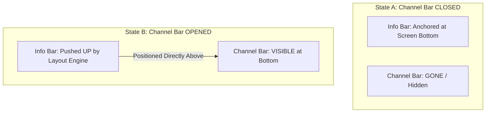

# TiViMate Channel Bar, Actions Bar & Info Bar — Complete Deep Dive

> A comprehensive architectural analysis of TiViMate's three primary OSD (On-Screen Display) overlay systems, traced directly from decompiled source code. Covers every aspect: layout structure, animation pipelines, D-pad input routing, visibility state machines, auto-hide timers, buffering indicator behavior, player state callbacks, and how all three bars coordinate with each other during live TV playback.

---

## Table of Contents

1. [High-Level Architecture Overview](#1-high-level-architecture-overview)
2. [The Three-Layer Window Stack](#2-the-three-layer-window-stack)
3. [The Info Bar System (OSD Overlay)](#3-the-info-bar-system-osd-overlay)
4. [The Channel Bar System](#4-the-channel-bar-system)
5. [The Actions Bar (Quick Actions / Player Controls)](#5-the-actions-bar-quick-actions--player-controls)
6. [The Animation Engine (C3840)](#6-the-animation-engine-c3840)
7. [The Visibility State Machine](#7-the-visibility-state-machine)
8. [Auto-Hide Timer System](#8-the-auto-hide-timer-system)
9. [D-Pad Input Routing & Key Dispatch](#9-d-pad-input-routing--key-dispatch)
10. [Buffering Behavior & OSD During Buffer States](#10-buffering-behavior--osd-during-buffer-states)
11. [Player State Callbacks & UI Synchronization](#11-player-state-callbacks--ui-synchronization)
12. [The Buffered Position & Time Bar](#12-the-buffered-position--time-bar)
13. [Track Selection (Audio/Subtitle) from Actions Bar](#13-track-selection-audiosubtitle-from-actions-bar)
14. [Playback Speed Control from Actions Bar](#14-playback-speed-control-from-actions-bar)
15. [Aspect Ratio / Zoom Cycling](#15-aspect-ratio--zoom-cycling)
16. [VOD vs Live TV Mode Differences](#16-vod-vs-live-tv-mode-differences)
17. [Complete Class Map & Source References](#17-complete-class-map--source-references)

---

## 1. High-Level Architecture Overview

TiViMate's OSD system is built on top of a **customized Media3 (ExoPlayer) PlayerView** (`CustomPlayerView` extending `AbstractC3857`) that contains within it a **PlayerControlView** (`C3860`). This is not a standard out-of-the-box ExoPlayer UI — it's heavily modified to support TV-optimized overlays, multi-state animations, and D-pad-centric navigation.

```
┌─────────────────────────────────────────────────────────────────────┐
│                    CustomPlayerView (AbstractC3857)                  │
│  ┌──────────────────────────────────────────────────────────────┐   │
│  │  AspectRatioFrameLayout (f14943)                             │   │
│  │  ├── SurfaceView (f14926) ──► ExoPlayer Video Output        │   │
│  │  └── [Video renders on hardware layer behind all UI]        │   │
│  ├──────────────────────────────────────────────────────────────┤   │
│  │  Shutter View (f14919) ──► Black overlay during transitions │   │
│  ├──────────────────────────────────────────────────────────────┤   │
│  │  Buffering Indicator (f14938) ──► Spinner/ProgressBar       │   │
│  ├──────────────────────────────────────────────────────────────┤   │
│  │  SubtitleView (f14948)                                      │   │
│  ├──────────────────────────────────────────────────────────────┤   │
│  │  Error Message TextView (f14946)                            │   │
│  ├──────────────────────────────────────────────────────────────┤   │
│  │  PlayerControlView / C3860 (f14949)                         │   │
│  │  ┌─────────────────────────────────────────────────────┐    │   │
│  │  │  ┌── Top Bar (time, duration, etc.)                 │    │   │
│  │  │  ├── Center Controls (play/pause, rew, fwd)         │    │   │
│  │  │  ├── Bottom Bar (time bar, position text)           │    │   │
│  │  │  ├── Overflow / Extra controls                      │    │   │
│  │  │  └── Managed by Animation Engine (C3840)            │    │   │
│  │  └─────────────────────────────────────────────────────┘    │   │
│  ├──────────────────────────────────────────────────────────────┤   │
│  │  Overlay FrameLayout (f14950) ──► Ad overlays, custom UI    │   │
│  └──────────────────────────────────────────────────────────────┘   │
└─────────────────────────────────────────────────────────────────────┘
```

### The Three OSD Elements in TiViMate's Live TV Context:

| Element | What It Shows | Trigger | Position |
|---------|--------------|---------|----------|
| **Info Bar** | Channel number, name, logo, current EPG program title, next program, progress bar, HD/SD badges, time | Channel change (Up/Down) or single D-pad press | Bottom of screen |
| **Channel Bar** | Horizontal scrollable list of channels in the current group with logos and names | D-pad Center press | Bottom of screen (pushes Info Bar up) |
| **Actions Bar** | Play/Pause, Subtitles, Audio Track, Zoom Mode, PiP, Sleep Timer, Playback Speed, etc. | Long-press D-pad Center or Down | Bottom of screen (replaces/overlays) |

---

## 2. The Three-Layer Window Stack

TiViMate renders video behind all UI using a strict hardware-composited depth stack. This is **critical** to understanding how the bars overlay without blocking video:

```
  ┌────────────────────────────────────────────────────────┐
  │ Layer 2: Interactive UI (Info Bar, Channel Bar, etc.)  │ ◄─ Translucent HSL fills (#CC0B0F19)
  ├────────────────────────────────────────────────────────┤
  │ Layer 1: Legibility Scrim (Dynamic Alpha View)        │ ◄─ Animates alpha 0.0f → 0.6f over 200ms
  ├────────────────────────────────────────────────────────┤
  │ Layer 0: Hardware Media Player (SurfaceView)          │ ◄─ Composited behind main window
  └────────────────────────────────────────────────────────┘
```

### Why SurfaceView (Not TextureView)
- `SurfaceView` renders on a **dedicated hardware surface** directly behind the main window layer
- Main UI thread animations (EPG scrolling, bar slide-ins) **cannot stutter the video**
- Requires the entire main window to be translucent (set in theme):

```xml
<style name="Theme.TvPlayer.Translucent" parent="Theme.Leanback">
    <item name="android:windowBackground">@android:color/transparent</item>
    <item name="android:windowIsTranslucent">true</item>
    <item name="android:backgroundDimEnabled">false</item>
</style>
```

### Static Glassmorphism (No GPU Blur)
TiViMate achieves its premium glassmorphic look using **semi-translucent HSL colors** (e.g., `#CC0B0F19` = 80% opaque deep slate) with subtle `1dp` transparent strokes (`#26FFFFFF`). **No real-time Gaussian blur** is ever used — this would destroy frame rates on budget Firesticks.

---

## 3. The Info Bar System (OSD Overlay)

### What the Info Bar Displays

```
┌──────────────────────────────────────────────────────────────────────────────┐
│  [Logo]  101 HBO HD   │  Westworld (S1 • E3)               │ 09:20 - 10:20   │
│                       │  Next: Game of Thrones             │ Progress: [██░] │
└──────────────────────────────────────────────────────────────────────────────┘
```

### Data Sources
- **Channel Number & Name**: From the `channels` SQLite table
- **Current & Next Program**: Real-time EPG query against `tvg_programs` table using epoch timestamps
- **HD/SD/Stereo/CC Badges**: Extracted from active `TrackGroup` metadata in the running ExoPlayer instance
- **Channel Logo**: Loaded from cached BLOB data or URL via the logo resolution pipeline
- **Progress Bar**: Calculated from current time vs EPG program start/end timestamps

### EPG Resolution Query
The Info Bar queries EPG data on-the-fly using joined SQLite tables:
```sql
SELECT p.title, p.start_time, p.end_time, p.description
FROM tvg_programs p
INNER JOIN channel_tvg_bindings b ON p.tvg_id = b.tvg_id
WHERE b.channel_id = ? AND p.start_time <= ? AND p.end_time > ?
ORDER BY p.start_time ASC
LIMIT 2
```
This returns both the current and next program in a single query.

### Shutter View Behavior
When the Info Bar appears during a channel change, a **Shutter View** (`f14919`) provides visual feedback:
- The shutter is a simple `View` with a black background
- On channel change, it fades in with a **150ms alpha animation** (`0.0f → 1.0f`) via `m8033()`
- Once the first video frame renders (`onRenderedFirstFrame`), the shutter is hidden (`GONE`) via `RunnableC3847`

**Source**: `AbstractC3857.java` lines 1127-1140:
```java
public final void m8033(boolean z) {
    View view = this.f14919; // Shutter view
    if (view == null || view.getVisibility() == 0) return;
    view.setVisibility(0); // VISIBLE
    if (!z) {
        view.setAlpha(1.0f);
    } else {
        view.setAlpha(0.0f);
        view.animate().alpha(1.0f).withLayer().setDuration(150L);
    }
}
```

### Fading Handler & Auto-Hide
The Info Bar's visibility is managed by the parent controller (`C3860`) through handler-based timer loops. After appearing, it auto-hides after a configurable timeout (default **5,000ms**), triggering a decelerated alpha fade-out animation.

---

## 4. The Channel Bar System

### Trigger: D-Pad Center Press
Pressing `KEYCODE_DPAD_CENTER` (keycode 23) during live playback activates the Channel Bar — a horizontal scrollable list of channels within the current channel group.

### Layout Stacking Strategy
The Info Bar and Channel Bar live inside a **single vertical container** aligned to the bottom of the screen:

```xml
<!-- Conceptual representation of the OSD Stacking Container -->
<LinearLayout
    android:layout_width="match_parent"
    android:layout_height="wrap_content"
    android:orientation="vertical"
    android:layout_gravity="bottom"
    android:clipChildren="false">

    <!-- Info Bar sits above -->
    <FrameLayout
        android:id="@+id/info_bar_container"
        android:layout_width="match_parent"
        android:layout_height="wrap_content"
        android:background="@drawable/glass_panel_stroke" />

    <!-- Channel Bar sits below (GONE when hidden) -->
    <FrameLayout
        android:id="@+id/channel_bar_container"
        android:layout_width="match_parent"
        android:layout_height="wrap_content"
        android:visibility="gone" />

</LinearLayout>
```

### Dynamic Push Transitions



**How it works:**
1. **Closed State**: Channel Bar is `View.GONE`. The vertical `LinearLayout` wraps content, so Info Bar rests at screen bottom.
2. **D-Pad Center Press**: Channel Bar is set to `View.VISIBLE`.
3. **Auto Layout Engine**: The parent `LinearLayout` re-measures. Because it's vertical, it **automatically expands upward**, pushing the Info Bar up — no manual coordinate math needed.
4. **Focus Routing**: Focus is immediately routed to the Channel Bar's `HorizontalGridView` via `.requestFocus()`. Horizontal D-pad navigates channels.
5. **Back Press** (`KEYCODE_BACK`, keycode 4): Resets Channel Bar to `GONE`, Info Bar slides back to bottom.

### Channel Bar Content
The Channel Bar is populated from the active channel group's channels query, displaying:
- Channel logo (cached BLOB)
- Channel number
- Channel name
- Current program title (from EPG)
- A highlight ring on the currently tuned channel

---

## 5. The Actions Bar (Quick Actions / Player Controls)

### Trigger: Long-Press D-Pad Center/Down
Long-pressing D-pad Center or Down summons the customizable Quick Actions Bar.

```
┌──────────────────────────────────────────────────────────────────────────────┐
│ [Play/Pause] [Subtitles] [Audio Track] [Zoom Mode] [PiP] [Sleep Timer]     │
└──────────────────────────────────────────────────────────────────────────────┘
```

### Window Interception for Long-Press Detection
Hardware key events are caught globally in `MainActivity.dispatchKeyEvent()`:

```kotlin
if (event.action == KeyEvent.ACTION_DOWN && event.repeatCount > 0) {
    // This is a long-press — open Actions Bar
}
```

**Source**: `AbstractC3857.java` line 486 — D-pad key detection:
```java
boolean z = keyCode == 19 || keyCode == 270 || keyCode == 22 ||
            keyCode == 271 || keyCode == 20 || keyCode == 269 ||
            keyCode == 21 || keyCode == 268 || keyCode == 23;
```
Key codes: 19=UP, 20=DOWN, 21=LEFT, 22=RIGHT, 23=CENTER, 268-271=extended D-pad.

### Dynamic View Inflation from User Preferences
The Actions Bar is **not statically defined** — it's built dynamically from user preferences:

1. User's button selections and order are stored in `SharedPreferences` as a serialized array (e.g., `["AUDIO_TRACK", "SUBTITLES", "ZOOM"]`)
2. On launch, the OSD controller (`C3860`) parses this array
3. Filters out disabled actions
4. Dynamically populates `ImageButton` items inside a horizontal row container

### Actions Bar Buttons & Their Source Bindings

| Button | View ID | Icon Resource | Click Handler |
|--------|---------|---------------|---------------|
| Play/Pause | `f15026` | `f14963` (play) / `f15008` (pause) | `ViewOnClickListenerC3849.onClick()` → `AbstractC3712.m7796()` |
| Previous | `f14958` | via drawable resource | → `player.seekToPrevious()` |
| Next | `f14997` | via drawable resource | → `player.seekToNext()` |
| Rewind | `f15012` | via drawable resource | → `player.seekBack(rewindIncrementMs)` |
| Fast Forward | `f14976` | via drawable resource | → `player.seekForward(fastForwardIncrementMs)` |
| Subtitles | `f15007` | dynamic based on track state | Opens subtitle track popup (`C3842`) |
| Repeat | `f14970` | toggles between none/one/all | Cycles repeat mode on player |
| Shuffle | `f15017` | toggles on/off | Toggles shuffle on player |
| Fullscreen | `f14988`/`f15010` | enter/exit fullscreen icons | Toggles fullscreen mode |
| Playback Speed | `f14957` | dynamic speed label | Opens speed selector popup (`C3854`) |
| VR | `f15009` | VR icon | Custom VR button listener |

### Speed Selector
The playback speed popup offers preset values: **0.25x, 0.5x, 0.75x, 1.0x, 1.25x, 1.5x, 2.0x**

**Source**: `C3860.java` line 313:
```java
f14953 = new float[]{0.25f, 0.5f, 0.75f, 1.0f, 1.25f, 1.5f, 2.0f};
```

When selected, speed is applied directly to the player without restarting:
```java
private void setPlaybackSpeed(float f) {
    C1485 c1485 = new C1485(f, currentPitch);
    player.setPlaybackParameters(c1485);
}
```

### Popup Menus for Track Selection
When clicking Subtitles or Audio buttons, a `PopupWindow` is displayed:

**Source**: `C3860.java` lines 635-637:
```java
RecyclerView recyclerView = (RecyclerView) inflate(R.layout.u_res_0x7f0e003e);
recyclerView.setAdapter(c1432); // Track options adapter
recyclerView.setLayoutManager(new LinearLayoutManager(VERTICAL));
PopupWindow popupWindow = new PopupWindow(recyclerView, WRAP_CONTENT, WRAP_CONTENT, true);
```

The popup is positioned relative to the clicked button:
```java
popupWindow.showAsDropDown(view, width - popupWidth - margin, -popupHeight - margin);
```

---

## 6. The Animation Engine (C3840)

The `C3840` class is the **core animation orchestrator** for all OSD show/hide transitions. It manages **5 separate `AnimatorSet` instances** and coordinates multi-view alpha/translationY animations.

### View Groups Managed by C3840

| Field | View | Purpose |
|-------|------|---------|
| `f14873` | Background/scrim view | Full-screen translucent overlay behind controls |
| `f14853` | Top bar container | Clock, duration text |
| `f14863` | Bottom bar container | Progress bar, position/duration text |
| `f14859` | Center controls container | Play/pause, rewind, fast-forward buttons |
| `f14851` | Time bar / seek bar area | DefaultTimeBar widget |
| `f14877` | Extra controls bar | Overflow buttons |
| `f14868` | Overflow menu container | Collapsed overflow items |
| `f14870` | Overflow items panel | Slide-in panel for extra controls |
| `f14858` | Time bar view | The actual DefaultTimeBar |
| `f14866`/`f14873` | Clickable overlay zones | For toggling between bar states |

### Animation Sets (250ms duration each)

```
AnimatorSet f14876 ──► Full hide animation (state 0 → hidden)
                       Fades alpha 1.0→0.0 + translates Y (0→dimension)
                       
AnimatorSet f14860 ──► Partial transition (state 1 → state 2)
                       Translates Y (dimension → dimension2)
                       
AnimatorSet f14869 ──► Full close animation (state 0 → state 2)
                       Fades alpha + translates Y (0 → dimension2)
                       
AnimatorSet f14861 ──► Partial open animation (state 2 → state 1)
                       Translates Y (dimension → 0)
                       
AnimatorSet f14852 ──► Full open from hidden (state 2 → state 0)
                       Translates Y (dimension2 → 0)

ValueAnimator f14871 ──► Overflow panel slide-in (alpha 0→1, 250ms)
ValueAnimator f14875 ──► Overflow panel slide-out (alpha 1→0, 250ms)
```

### The `translationY` Dimension Math
Two dimension values from resources drive the vertical slide distances:
```java
float dimension  = resources.getDimension(R.dimen.u_res_0x7f0700b9) 
                 - resources.getDimension(R.dimen.u_res_0x7f0700be);
float dimension2 = resources.getDimension(R.dimen.u_res_0x7f0700b9);
```
These represent the **height of the control bar** and the **total slide distance** — the bars slide up from below the screen using `ObjectAnimator.ofFloat(view, "translationY", from, to)`.

### Alpha Animation on Show/Hide
When fading in/out, these views have their alpha animated simultaneously:
- `f14873` (scrim/background)
- `f14853` (top bar)
- `f14863` (bottom bar)

**Source**: `C3840.java` lines 146-163 — the `ValueAnimator` update listener:
```java
float alpha = ((Float) valueAnimator.getAnimatedValue()).floatValue();
if (scrimView != null) scrimView.setAlpha(alpha);
if (topBar != null) topBar.setAlpha(alpha);
if (bottomBar != null) bottomBar.setAlpha(alpha);
```

### Overflow Panel Animation
The overflow panel (`f14870`) slides in from the right using `translationX`:
```java
public final void m8010(float f) {
    ViewGroup overflowPanel = this.f14870;
    if (overflowPanel != null) {
        overflowPanel.setTranslationX((int) ((1.0f - f) * overflowPanel.getWidth()));
    }
    // Simultaneously fade out the time bar and extra controls
    if (timeBar != null) timeBar.setAlpha(1.0f - f);
    if (extraControls != null) extraControls.setAlpha(1.0f - f);
}
```

---

## 7. The Visibility State Machine

`C3840` tracks the current visibility state in `f14872`, which is an integer with **5 possible states**:

| State | Value | Meaning |
|-------|-------|---------|
| `STATE_VISIBLE` | 0 | Controls fully visible, interactable |
| `STATE_ANIMATING_SHOW` | 1 | Partially visible, mid-animation to show |
| `STATE_HIDDEN` | 2 | Controls fully hidden (`View.GONE` on the `C3860` container) |
| `STATE_ANIMATING_HIDE` | 3 | Mid-animation to hide |
| `STATE_ANIMATING_OVERFLOW` | 4 | Overflow panel is animating |

### State Transition Logic (`m8006` — Show Controls)

```java
public final void m8006() {
    if (!animationEnabled) {
        // No animation: jump directly to visible
        setState(STATE_VISIBLE);
        startHideTimer();
        return;
    }
    int currentState = this.f14872;
    if (currentState == STATE_ANIMATING_SHOW) {
        // Coming from partial show → continue to full show
        f14861.start(); // AnimatorSet: partial → full
    } else if (currentState == STATE_HIDDEN) {
        // Coming from fully hidden → show everything
        f14852.start(); // AnimatorSet: hidden → visible
    } else if (currentState == STATE_ANIMATING_HIDE) {
        // Was hiding, mark to reverse after animation completes
        f14867 = true; // "reverse" flag
    } else if (currentState == STATE_ANIMATING_OVERFLOW) {
        return; // Don't interrupt overflow animation
    }
    startHideTimer();
}
```

### State Transition: Hide Controls (`m8059`)

```java
public final void m8059() {
    int currentState = c3840.f14872;
    if (currentState == STATE_ANIMATING_HIDE || currentState == STATE_HIDDEN) {
        return; // Already hiding or hidden
    }
    c3840.cancelPendingHideTimers();
    if (!c3840.animationEnabled) {
        c3840.setState(STATE_HIDDEN);
    } else if (c3840.f14872 == STATE_ANIMATING_SHOW) {
        c3840.f14860.start(); // Reverse: partial show → hide
    } else {
        c3840.f14869.start(); // Full visible → hide
    }
}
```

### View Visibility on State Change (`m8004`)

```java
public final void m8004(int newState) {
    int oldState = this.f14872;
    this.f14872 = newState;
    if (newState == STATE_HIDDEN) {
        controller.setVisibility(View.GONE); // Completely remove from layout
    } else if (oldState == STATE_HIDDEN) {
        controller.setVisibility(View.VISIBLE); // Bring back
    }
    // Notify all visibility listeners
    for (InterfaceC3863 listener : controller.f15001) {
        ((ViewOnClickListenerC3868) listener).f15051.m8030();
    }
}
```

---

## 8. The Auto-Hide Timer System

The auto-hide system uses `postDelayed()` callbacks on the `C3860` view to schedule hide events.

### Timer Configuration
- **Default show timeout**: **5,000ms** (`f14974 = 5000`)
- **Quick dismiss (during animation)**: **2,000ms**
- **Minimum time bar update interval**: **200ms** (`f14991 = 200`)

### The Timer Hierarchy (`m8007`)

```java
public final void m8007() {
    if (currentState == STATE_ANIMATING_HIDE) return; // Don't set timers while hiding
    
    cancelAllPendingTimers();
    
    int showTimeout = controller.getShowTimeoutMs();
    if (showTimeout > 0) {
        if (!animationEnabled) {
            // No animation: schedule direct hide after timeout
            postDelayed(directHideRunnable, showTimeout);
        } else if (currentState == STATE_ANIMATING_SHOW) {
            // Currently showing: wait 2s then start phase-2 hide
            postDelayed(phase2HideRunnable, 2000L);
        } else {
            // Fully visible: schedule full hide after timeout
            postDelayed(fullHideRunnable, showTimeout);
        }
    }
}
```

### The 6 Runnable Types in `RunnableC3846`

| Case | Runnable Purpose |
|------|-----------------|
| 0 | Show controls (`m8006()`) |
| 1 | Layout recalculation — adjusts time bar margins, repositions overflow items, handles responsive button overflow |
| 2 | Overflow button redistribution — moves buttons between primary bar and overflow panel based on available width |
| 3 | Start phase-2 hide animation (`f14869.start()`) |
| 4 | Start phase-1 hide animation (`f14860.start()`) |
| 5 | Start full hide animation + schedule phase-2 after 2s (`f14876.start(); postDelayed(phase2, 2000)`) |
| 6 (default) | Immediate hide — set state to `STATE_HIDDEN` directly |

### Responsive Overflow Button System
When the control bar is too narrow to fit all buttons, `RunnableC3846` case 2 performs **dynamic button redistribution**:

```java
// Measure total width of all buttons
int totalWidth = measureAllButtonWidths();
int availableWidth = controller.getWidth() - padding;

if (totalWidth > availableWidth) {
    // Move excess buttons from primary bar to overflow panel
    showOverflowToggle();
    while (totalWidth > availableWidth) {
        View button = removeLastFromPrimaryBar();
        addToOverflowPanel(button);
        totalWidth -= measureButtonWidth(button);
    }
} else {
    // All buttons fit — hide overflow panel with slide-out animation
    if (overflowPanel.isVisible() && !slideOutAnimator.isStarted()) {
        slideInAnimator.cancel();
        slideOutAnimator.start();
    }
}
```

---

## 9. D-Pad Input Routing & Key Dispatch

### The Two-Level Key Interception

**Level 1: CustomPlayerView (`AbstractC3857.dispatchKeyEvent`)**

This is the outer player view. It intercepts keys first:

```java
public final boolean dispatchKeyEvent(KeyEvent keyEvent) {
    // If player is playing an ad, pass through to super
    if (player != null && player.isPlayingAd() && player.isPlaying()) {
        return super.dispatchKeyEvent(keyEvent);
    }
    
    int keyCode = keyEvent.getKeyCode();
    boolean isNavKey = keyCode == UP || keyCode == DOWN || keyCode == LEFT ||
                       keyCode == RIGHT || keyCode == CENTER;
    
    C3860 controller = this.f14949;
    
    // If it's a nav key AND controller is enabled AND controller is NOT visible
    if (isNavKey && useController() && !controller.isVisible()) {
        showController(true); // Show on any nav key press
        return true; // Consume the key
    }
    
    // If controller is enabled, let controller try to handle the key
    if ((useController() && controller.handleKeyEvent(keyEvent)) ||
         super.dispatchKeyEvent(keyEvent)) {
        showController(true); // Reset hide timer
        return true;
    }
    
    // Reset timer even for unhandled nav keys
    if (isNavKey && useController()) {
        showController(true);
    }
    return false;
}
```

**Level 2: PlayerControlView (`C3860.m8051` — Key Handling)**

The controller handles media-specific keys:

```java
public final boolean m8051(KeyEvent keyEvent) {
    int keyCode = keyEvent.getKeyCode();
    
    // Only handle these specific media keys:
    // 90=FAST_FORWARD, 89=REWIND, 85=PLAY_PAUSE, 79=HEADSETHOOK,
    // 126=PLAY, 127=PAUSE, 87=NEXT, 88=PREVIOUS
    if (player == null || !isMediaKey(keyCode)) return false;
    
    if (keyEvent.getAction() == ACTION_DOWN) {
        switch (keyCode) {
            case FAST_FORWARD:
                if (player.getPlaybackState() != STATE_ENDED) {
                    player.seekForward(fastForwardIncrementMs);
                }
                break;
            case REWIND:
                player.seekBack(-rewindIncrementMs);
                break;
            case PLAY_PAUSE:
            case HEADSETHOOK:
                if (shouldShowPlayButton()) {
                    player.play();
                } else {
                    player.pause();
                }
                break;
            case NEXT:
                player.seekToNext();
                break;
            case PREVIOUS:
                player.seekToPrevious();
                break;
            case PLAY:
                player.play();
                break;
            case PAUSE:
                player.pause();
                break;
        }
    }
    return true;
}
```

### Long-Press Detection for Actions Bar
The long-press detection happens in the activity-level `dispatchKeyEvent`:

```kotlin
override fun dispatchKeyEvent(event: KeyEvent): Boolean {
    if (event.action == KeyEvent.ACTION_DOWN && event.repeatCount > 0) {
        // Long press detected — open Actions Bar
        showQuickActionsOverlay()
        return true
    }
    // Short press — handle normally (Info Bar, Channel Bar, etc.)
    return super.dispatchKeyEvent(event)
}
```

---

## 10. Buffering Behavior & OSD During Buffer States

### The Buffering Indicator View

The buffering spinner is a dedicated view (`f14938`) inside `CustomPlayerView`:

```java
View bufferingView = findViewById(R.id.u_res_0x7f0b015f);
this.f14938 = bufferingView;
if (bufferingView != null) {
    bufferingView.setVisibility(View.GONE); // Hidden by default
}
```

### Show Buffering Modes
`setShowBuffering(int i)` accepts three modes:

| Value | Mode | Behavior |
|-------|------|----------|
| 0 | `SHOW_BUFFERING_NEVER` | Never show the buffering spinner |
| 1 | `SHOW_BUFFERING_WHEN_PLAYING` | Show spinner only when player is supposed to be playing but is buffering |
| 2 | `SHOW_BUFFERING_ALWAYS` | Always show spinner when player is in `STATE_BUFFERING` |

The `m8035()` method (abstract, implemented in `CustomPlayerView`) evaluates the current player state and buffering mode to toggle the spinner visibility.

### Buffering Watchdog System (5-Second Timer)
TiViMate implements a **dual-layer buffering watchdog** that detects stuck streams:

```
[ Video Playing: STATE_READY ]
       │
       ▼ (Packets Stop Arriving)
[ Player enters STATE_BUFFERING ] ──► Start Watchdog Timer (5,000ms)
       │
       ├─────────────────────────────┐
       ▼ (Packets Resume < 5s)      ▼ (Timer Expires: FROZEN!)
[ Cancel Watchdog / Resume ]   [ Trigger Silent Resync ]
                                      │
                                      ▼
                                * Dispose active socket
                                * Query Native Core for Fresh URL
                                * Re-prepare ExoPlayer instance
```

### OSD Behavior During Buffering

When buffering starts, several things happen simultaneously:

1. **Buffering Spinner Appears**: `f14938` visibility set to `VISIBLE`
2. **Controller Auto-Show Logic**: The `m8024()` method checks if auto-show should trigger:

```java
public final boolean m8024() {
    InterfaceC1488 player = this.f14918;
    if (player == null) return true;
    
    int playbackState = player.getPlaybackState();
    
    if (!this.f14940) return false; // controllerAutoShow disabled
    
    // Don't show controller if timeline is empty (no content loaded yet)
    if (player.hasTimeline() && player.getTimeline().isEmpty()) return false;
    
    // Auto-show when IDLE (1) or ENDED (4)
    if (playbackState != STATE_IDLE && playbackState != STATE_ENDED) {
        // For READY or BUFFERING states, only show if NOT playing
        if (player.isPlaying()) return false;
    }
    return true;
}
```

**Key Insight**: During `STATE_BUFFERING`, if `isPlaying()` returns `false` (the player has paused due to buffering), the controller **auto-shows** — displaying the Info Bar with the buffering spinner. But if the player is still marked as "playing" (just temporarily buffering), the controller stays hidden to avoid visual interruption.

3. **Time Bar Progress Freezes**: The progress update runnable (`f14998`) checks playback state:

```java
// In m8056() — progress update method
int playbackState = player.getPlaybackState();
if (player != null && playbackState == STATE_READY && player.isPlaying()) {
    // Schedule next update based on playback speed
    float speed = player.getPlaybackParameters().speed;
    long delay = speed > 0 ? (long)(updateInterval / speed) : 1000L;
    postDelayed(progressUpdateRunnable, constrainDelay(delay, minInterval, 1000));
} else if (playbackState == STATE_ENDED || playbackState == STATE_IDLE) {
    // Stop updating
    return;
} else {
    // BUFFERING state: still update every 1s to show buffered position growth
    postDelayed(progressUpdateRunnable, 1000L);
}
```

4. **Buffered Position Indicator**: Even while buffering, the time bar continues showing the **buffered position** growing:

```java
InterfaceC3875 timeBar = this.f15029;
if (timeBar != null) {
    timeBar.setPosition(currentPosition);
    timeBar.setBufferedPosition(bufferedPosition); // Shows grey fill growing
}
```

### The Shutter During Channel Changes
When changing channels, the **shutter view** (black overlay) fades in to hide the old video while the new stream loads. The sequence:

1. Channel change triggered
2. Shutter fades in (150ms alpha animation)
3. New stream URL prepared in ExoPlayer
4. ExoPlayer enters `STATE_BUFFERING`
5. Buffering spinner appears (if mode > 0)
6. First frame renders → `onRenderedFirstFrame` callback fires
7. Shutter fades out / hides → video is visible
8. Buffering spinner hides
9. Info Bar shows with new channel info (auto-hides after timeout)

### First-Frame Safety Check
If ExoPlayer transitions to `STATE_READY` but no frame is actually rendered to the surface within 5 seconds, the watchdog considers it a **decoder lock-up** and triggers a silent resync.

---

## 11. Player State Callbacks & UI Synchronization

The `ViewOnClickListenerC3849` class implements `InterfaceC1487` (ExoPlayer's `Player.Listener`) and receives all player state callbacks.

### Key Callback: `mo2850` (onEvents)

This is the **master event handler** that updates all OSD elements based on player events:

```java
public final void mo2850(C1483 events) {
    C3860 controller = this.f14897;
    
    // Events 4, 5, 13 → Update play/pause button state
    if (events.containsAny(PLAYBACK_STATE_CHANGED, PLAY_WHEN_READY_CHANGED, AVAILABLE_COMMANDS_CHANGED)) {
        controller.updatePlayPauseButton();
    }
    
    // Events 4, 5, 7, 13 → Update progress / position
    if (events.containsAny(PLAYBACK_STATE_CHANGED, PLAY_WHEN_READY_CHANGED, POSITION_DISCONTINUITY, AVAILABLE_COMMANDS_CHANGED)) {
        controller.updateProgress();
    }
    
    // Events 8, 13 → Update repeat mode toggle
    if (events.containsAny(REPEAT_MODE_CHANGED, AVAILABLE_COMMANDS_CHANGED)) {
        controller.updateRepeatButton();
    }
    
    // Events 9, 13 → Update shuffle button
    if (events.containsAny(SHUFFLE_MODE_CHANGED, AVAILABLE_COMMANDS_CHANGED)) {
        controller.updateShuffleButton();
    }
    
    // Events 8, 9, 11, 0, 16, 17, 13 → Update navigation buttons
    if (events.containsAny(REPEAT_MODE_CHANGED, SHUFFLE_MODE_CHANGED, TIMELINE_CHANGED,
                           MEDIA_ITEM_TRANSITION, SEEK_BACK_INCREMENT_CHANGED, 
                           SEEK_FORWARD_INCREMENT_CHANGED, AVAILABLE_COMMANDS_CHANGED)) {
        controller.updateNavigationButtons();
    }
    
    // Events 11, 0, 13 → Update timeline/duration
    if (events.containsAny(TIMELINE_CHANGED, MEDIA_ITEM_TRANSITION, AVAILABLE_COMMANDS_CHANGED)) {
        controller.updateTimeline();
    }
    
    // Events 12, 13 → Update playback speed display
    if (events.containsAny(PLAYBACK_PARAMETERS_CHANGED, AVAILABLE_COMMANDS_CHANGED)) {
        controller.updatePlaybackSpeedDisplay();
    }
    
    // Events 2, 13 → Update track selection (subtitle/audio buttons)
    if (events.containsAny(TRACKS_CHANGED, AVAILABLE_COMMANDS_CHANGED)) {
        controller.updateTrackSelectionButtons();
    }
}
```

### Key Callback: `mo2828` (onPlaybackStateChanged)

In the outer `ViewOnClickListenerC3868`, this handles auto-show/hide of controls based on play state:

```java
public final void mo2828(int playbackState) {
    CustomPlayerView playerView = this.f15051;
    playerView.updateBufferingVisibility(); // m8035()
    playerView.updateErrorMessage();        // m8025()
    
    // If playing an ad and hideControlsDuringAds is set, hide controls
    if (playerView.isPlayingAd() && playerView.hideControlsDuringAds) {
        controller.hide();
        return;
    }
    // Otherwise, auto-show/hide based on state
    playerView.maybeShowController(false);
}
```

### Key Callback: `mo2833` (onPlayWhenReadyChanged)

```java
public final void mo2833(int playWhenReady, C1456 reason, C1456 reason2) {
    // If transitioning to/from ad state, update control visibility
    if (playerView.isPlayingAd() && playerView.hideControlsDuringAds) {
        controller.hide();
    }
    // When state is IDLE (1) or ENDED (4), update artwork/content
    if (playWhenReady == IDLE || playWhenReady == ENDED) {
        playerView.updateContentDisplay();
    }
}
```

---

## 12. The Buffered Position & Time Bar

### Time Bar Implementation
The `C3860` controller contains a `DefaultTimeBar` (`InterfaceC3875 f15029`) that shows:
- **Current position** (solid colored fill)
- **Buffered position** (semi-transparent fill extending beyond current position)
- **Duration** (total bar width)
- **Ad markers** (dots/marks for ad positions)

### Progress Update Loop (`m8056`)

The progress is updated on a **self-scheduling loop**:

```java
public final void m8056() {
    if (!isVisible() || !isAttachedToWindow()) return;
    
    InterfaceC1488 player = this.f15025;
    long currentPosition, bufferedPosition;
    
    if (player == null || !player.canSeek()) {
        currentPosition = 0;
        bufferedPosition = 0;
    } else {
        currentPosition = player.getCurrentPosition() + windowOffset;
        bufferedPosition = player.getBufferedPosition() + windowOffset;
    }
    
    // Update position text
    if (positionText != null && !isScrubbing) {
        positionText.setText(formatTime(currentPosition));
    }
    
    // Update time bar
    if (timeBar != null) {
        timeBar.setPosition(currentPosition);
        // During scrubbing, buffered = current (prevents visual jump)
        if (isScrubbingMode()) bufferedPosition = currentPosition;
        timeBar.setBufferedPosition(bufferedPosition);
    }
    
    // Schedule next update
    removeCallbacks(progressRunnable);
    int playbackState = player.getPlaybackState();
    if (playbackState == STATE_READY && player.isPlaying()) {
        // Calculate update interval adjusted for playback speed
        long preferredDelay = Math.min(
            timeBar.getPreferredUpdateDelay(),
            1000 - (currentPosition % 1000) // Align to second boundaries
        );
        float speed = player.getPlaybackParameters().speed;
        long adjustedDelay = speed > 0 ? (long)(preferredDelay / speed) : 1000;
        postDelayed(progressRunnable, constrain(adjustedDelay, minUpdateInterval, 1000));
    } else if (playbackState != STATE_ENDED && playbackState != STATE_IDLE) {
        // BUFFERING: still update every 1s to show buffer growth
        postDelayed(progressRunnable, 1000);
    }
    // ENDED/IDLE: stop updating
}
```

### Scrubbing Mode
When the user is scrubbing (dragging the time bar), TiViMate enables **scrubbing mode** on the ExoPlayer:

```java
// On scrub start
public final void onScrubStart(long position) {
    isScrubbing = true;
    positionText.setText(formatTime(position));
    cancelHideTimers(); // Don't hide while scrubbing
    
    if (player instanceof ExoPlayer) {
        // Enable low-latency scrub preview
        ExoPlayer.setScrubbingModeEnabled(true);
    }
}

// On scrub stop
public final void onScrubStop(boolean cancelled, long position) {
    isScrubbing = false;
    if (!cancelled) {
        seekTo(player, position); // Execute the seek
    }
    if (player instanceof ExoPlayer) {
        ExoPlayer.setScrubbingModeEnabled(false);
    }
    restartHideTimer(); // Re-engage auto-hide
}
```

---

## 13. Track Selection (Audio/Subtitle) from Actions Bar

### Track Discovery
When the track buttons are rendered, `C3860.m8049()` queries available tracks from the player:

```java
public final void m8049() {
    C1454 trackInfo = player.getCurrentTracks();
    
    // Discover subtitle tracks (type == 3)
    List<TrackOption> subtitleTracks = discoverTracks(trackInfo, TEXT_TRACK_TYPE);
    subtitleTrackSelector.setTracks(subtitleTracks);
    
    // Discover audio tracks (type == 1)  
    if (showSubtitleButton) {
        List<TrackOption> audioTracks = discoverTracks(trackInfo, AUDIO_TRACK_TYPE);
        audioTrackSelector.setTracks(audioTracks);
    }
    
    // Update button label to show current audio track name
    C1463 currentSelection = player.getCurrentTrackSelections();
    if (hasActiveAudioTrack(currentSelection)) {
        speedAndTrackLabel = activeTrackName;
    } else {
        speedAndTrackLabel = "Auto";
    }
    
    // Enable/disable buttons based on track availability
    setEnabled(subtitleButton, subtitleTracks.size() > 0);
    setEnabled(trackMenuButton, hasAnyTracks);
}
```

### Instant Track Swapping
Track switching is done via `TrackSelectionParameters` — **no decoder restart**:

```kotlin
player.trackSelectionParameters = player.trackSelectionParameters
    .buildUpon()
    .setOverrideForType(TrackSelectionOverride(trackGroup, trackIndex))
    .build()
```

---

## 14. Playback Speed Control from Actions Bar

### The Speed Popup
Clicking the speed button opens a `PopupWindow` with a `RecyclerView` containing speed options. The `C3854` adapter holds:
- String labels: `["0.25x", "0.5x", "0.75x", "1x", "1.25x", "1.5x", "2x"]`
- Float values: `[0.25f, 0.5f, 0.75f, 1.0f, 1.25f, 1.5f, 2.0f]`

### Speed Application
Speed is applied to ExoPlayer's `PlaybackParameters` without stopping playback:

```java
private void setPlaybackSpeed(float speed) {
    if (player == null || !player.canSetPlaybackSpeed()) return;
    
    C1485 newParams = new C1485(speed, currentPitch);
    player.setPlaybackParameters(newParams);
}
```

### Speed Indicator Update (`m8063`)
After speed changes, the nearest predefined speed label is found and displayed:

```java
public final void m8063() {
    float currentSpeed = player.getPlaybackParameters().speed;
    float closestDiff = Float.MAX_VALUE;
    int closestIndex = 0;
    
    for (int i = 0; i < speedValues.length; i++) {
        float diff = Math.abs(currentSpeed - speedValues[i]);
        if (diff < closestDiff) {
            closestIndex = i;
            closestDiff = diff;
        }
    }
    
    speedLabel = speedLabels[closestIndex]; // e.g., "1.5x"
    menuAdapter.setItemLabel(SPEED_INDEX, speedLabel);
}
```

---

## 15. Aspect Ratio / Zoom Cycling

Aspect ratio changes are handled **purely at the layout layer** — hardware decoders are never restarted.

### The AspectRatioFrameLayout
`f14943` is an `AspectRatioFrameLayout` that wraps the `SurfaceView`. When the user cycles zoom modes:

```java
// In m8029() — aspect ratio update
C1469 videoSize = player.getVideoSize();
float aspectRatio = (videoSize.height == 0 || videoSize.width == 0) 
    ? 0.0f 
    : (videoSize.width * videoSize.pixelWidthHeightRatio) / videoSize.height;

if (aspectRatioFrameLayout != null) {
    aspectRatioFrameLayout.setAspectRatio(aspectRatio);
}
```

### Resize Modes
The `AspectRatioFrameLayout` supports these modes (set via `f1255`):
- **0 = FIT**: Scale to fit within bounds, maintaining aspect ratio (letterbox)
- **1 = FIXED_WIDTH**: Fix width, adjust height
- **2 = FIXED_HEIGHT**: Fix height, adjust width
- **3 = FILL**: Scale to fill bounds, cropping excess
- **4 = ZOOM**: Scale beyond bounds proportionally

---

## 16. VOD vs Live TV Mode Differences

The OSD system behaves differently for VOD vs Live TV:

| Feature | Live TV (`is_vod = 0`) | VOD (`is_vod = 1`) |
|---------|----------------------|---------------------|
| **Seek Bar** | Hidden (unless catch-up/timeshift) | **Always visible** with full time bar |
| **Info Bar Content** | EPG program data (title, next, progress) | Movie/episode title, duration |
| **Channel Bar** | Shows channels in current group | N/A — no channel concept |
| **Actions Bar** | Channel-switching focused | Seek/pause/resume focused |
| **Progress Tracking** | Not tracked | `resume_position_ms` saved per-movie |
| **Buffering Display** | Brief spinner during zap | Standard spinner + seek bar stall |
| **Rewind/FF Increment** | 5s default (`f17411`) | 15s default (`f17369`) |

### VOD-Specific Rewind/Forward Values
From `C3860.java` line 1007-1031:
```java
// Rewind increment (5s default for live TV)
if (player != null) {
    rewindMs = player.getRewindIncrement(); // f17411
} else {
    rewindMs = 5000;
}

// Fast-forward increment (15s default)
if (player != null) {
    ffMs = player.getFastForwardIncrement(); // f17369
} else {
    ffMs = 15000;
}
```

---

## 17. Complete Class Map & Source References

### Core Classes in Package `p312`

| Class | Role | Size |
|-------|------|------|
| **`AbstractC3857`** | Base CustomPlayerView — contains SurfaceView, subtitle view, shutter, buffering indicator, error text, and the controller (`C3860`). Handles D-pad dispatch, setPlayer(), setShowBuffering(), aspect ratio. | 47.9 KB |
| **`C3860`** | The PlayerControlView — the main OSD controller. Contains all buttons (play, rewind, ff, next, prev, subtitles, shuffle, repeat, fullscreen, speed, VR), the time bar, position/duration text, and the animation engine (`C3840`). Handles media key dispatch, track selection popups, progress updates. | 67.9 KB |
| **`C3840`** | The Animation Engine — manages 5 AnimatorSets for show/hide transitions (250ms each), alpha fading, translationY sliding, overflow panel translationX. Contains the visibility state machine (5 states). | 24.8 KB |
| **`ViewOnClickListenerC3849`** | Button click handler for all Actions Bar buttons + Player.Listener implementation. Routes clicks to player commands (play, pause, seek, repeat, shuffle, track swap, speed). Receives all player state events and triggers UI updates. | 14.2 KB |
| **`ViewOnClickListenerC3868`** | Outer player view listener — handles onPlaybackStateChanged, onPlayWhenReadyChanged, onTracksChanged for auto-show/hide of controls, shutter behavior, subtitle cue updates, and content display logic. | 10.8 KB |
| **`RunnableC3846`** | Timer/callback runnables for hide sequences (6 cases), layout recalculation, overflow button redistribution, and animation triggers. | 8.4 KB |
| **`RunnableC3847`** | Simple runnable for hiding the shutter view (`View.GONE`) or triggering invalidate. | 1.1 KB |
| **`C3841`** | Large utility class (66.9 KB) — likely contains the full TiViMate-specific OSD rendering, EPG info bar population, channel bar horizontal list management, and additional overlay customization logic beyond the base Media3 framework. | 66.9 KB |
| **`C3842`** | Track selection helper — manages lists of available audio/subtitle tracks for popup display. | 7.4 KB |
| **`C3851`** | Additional controller helper (20.0 KB) — likely handles extended OSD features. | 20.0 KB |
| **`C3854`** | Playback speed selector adapter — holds speed labels and float values, manages speed popup RecyclerView. | 808 B |
| **`C3864`** | Animator listener — receives animation start/end events to update state machine transitions. | 5.4 KB |
| **`C3869`** | Android 14 (API 34) compose surface sync workaround. | 1.6 KB |
| **`C3870`** | Extended control logic (8.1 KB). | 8.1 KB |
| **`C3872`** | Track format description builder — converts track metadata into human-readable strings for the track popup. | 6.2 KB |
| **`C3876`** | `OnLayoutChangeListener` — triggers layout recalculation when the control view dimensions change. | 834 B |
| **`C3877`** | Track option data class — holds track group index, track index, and display label. | 795 B |

### Key Resource IDs Referenced

| Resource ID | Widget | Purpose |
|-------------|--------|---------|
| `u_res_0x7f0b0162` | `AspectRatioFrameLayout` | Video container |
| `u_res_0x7f0b0184` | Shutter View | Black overlay during transitions |
| `u_res_0x7f0b015a` | `FrameLayout` | Ad overlay container |
| `u_res_0x7f0b0175` | `FrameLayout` | General overlay container |
| `u_res_0x7f0b016e` | `ImageView` | Image/poster display |
| `u_res_0x7f0b015b` | `ImageView` | Artwork view |
| `u_res_0x7f0b0187` | `SubtitleView` | Subtitle rendering |
| `u_res_0x7f0b015f` | Buffering View | Progress spinner |
| `u_res_0x7f0b0167` | `TextView` | Error message display |
| `u_res_0x7f0b0163` | `C3860` | PlayerControlView (the OSD controller) |
| `u_res_0x7f0b0165` | Scrim/BG View | Translucent background overlay |
| `u_res_0x7f0b0160` | Top Bar | Top info container |
| `u_res_0x7f0b0170` | Bottom Bar | Bottom info/progress container |
| `u_res_0x7f0b015e` | Center Controls | Play/pause/seek buttons |
| `u_res_0x7f0b0189` | Time Bar Area | Progress bar region |
| `u_res_0x7f0b017c` | `DefaultTimeBar` | Seekable progress bar |
| `u_res_0x7f0b015d` | Extra Controls | Overflow button area |
| `u_res_0x7f0b0168` | Overflow Container | Collapsed overflow buttons |
| `u_res_0x7f0b0169` | Overflow Items Panel | Expanded overflow buttons |
| `u_res_0x7f0b0178` | Play/Pause Button | Primary playback toggle |
| `u_res_0x7f0b0186` | Subtitle Button | Toggle subtitle track popup |
| `u_res_0x7f0b017e` | Repeat Button | Cycle repeat modes |
| `u_res_0x7f0b0183` | Shuffle Button | Toggle shuffle |
| `u_res_0x7f0b016c` | Fullscreen Min | Minimize fullscreen button |
| `u_res_0x7f0b0171` | Fullscreen Max | Maximize fullscreen button |
| `u_res_0x7f0b0166` | Duration Text | Total duration display |
| `u_res_0x7f0b017a` | Position Text | Current position display |

### ExoPlayer Custom Configuration

| Parameter | Value | Purpose |
|-----------|-------|---------|
| `minBufferMs` | 1,000ms | Minimum buffer before player stabilizes |
| `maxBufferMs` | 2,500ms | Maximum buffer cap (saves RAM on TV sticks) |
| `bufferForPlaybackMs` | 500ms | Start rendering after just 0.5s buffered — instant zapping |
| `bufferForPlaybackAfterRebufferMs` | 1,000ms | After a rebuffer event, only wait 1s to resume |
| `connectionTimeoutMs` | 5,000ms | Fast fail on dead streams |
| `readTimeoutMs` | 5,000ms | Fast fail on hung connections |
| Channel history delay | 5,000ms | Only commit to history DB if user stays 5+ seconds |

---

## Summary Flow: What Happens When You Press a Button

### Scenario A: Quick Channel Change (D-Pad Up)
```
1. dispatchKeyEvent() catches KEYCODE_DPAD_UP
2. Channel manager selects next channel in group
3. Shutter view fades in (150ms)
4. ExoPlayer source swapped to new stream URL
5. ExoPlayer enters STATE_BUFFERING
6. Buffering spinner appears (if mode > 0)
7. Info Bar shows with new channel name/EPG info
8. OkHttp reuses warm TCP socket → 500ms buffer fills
9. onRenderedFirstFrame fires → shutter hides
10. Buffering spinner hides
11. Auto-hide timer starts (5,000ms)
12. After 5s: Info Bar fade-out animation (250ms)
13. 5-second surfing delay filter: if stable, commit to history DB
```

### Scenario B: Open Channel Bar (D-Pad Center)
```
1. dispatchKeyEvent() catches KEYCODE_DPAD_CENTER (short press)
2. Controller checks: is visible? → No → show controller
3. C3840.m8006() triggers show animation
4. AnimatorSet plays: alpha 0→1 + translationY slide up (250ms)
5. Channel Bar container set to VISIBLE
6. LinearLayout re-measures → Info Bar pushed up automatically
7. Focus routed to HorizontalGridView → horizontal D-pad navigates channels
8. Auto-hide timer starts (5,000ms)
9. User selects channel → triggers channel change (Scenario A)
10. Or: Back pressed → Channel Bar GONE → Info Bar slides down
```

### Scenario C: Open Actions Bar (Long-Press D-Pad Center)
```
1. dispatchKeyEvent() detects repeatCount > 0 → long press
2. Actions Bar overlay opens at bottom
3. Buttons dynamically inflated from SharedPreferences order
4. Focus routed to first enabled button
5. User navigates with D-pad Left/Right
6. Clicking a button:
   - Play/Pause → toggle player state
   - Subtitles → open PopupWindow with track list
   - Audio → open PopupWindow with audio tracks
   - Zoom → cycle AspectRatioFrameLayout resize mode
   - Speed → open speed selector popup
7. Auto-hide timer paused during popup interaction
8. Back pressed → Actions Bar hides with fade-out animation
```

### Scenario D: Buffering Mid-Stream (Network Stall)
```
1. Stream packets stop arriving (socket hung)
2. ExoPlayer buffer drains → STATE_BUFFERING
3. Buffering spinner appears immediately
4. Watchdog timer starts (5,000ms)
5. Progress bar freezes at current position
6. Buffered position indicator may still grow (if partial data arrives)
7. Controller visibility:
   - If controllerAutoShow=true AND !isPlaying → controller shows
   - Otherwise → only spinner visible, no controller
8. If packets resume < 5s:
   - Watchdog cancelled
   - STATE_READY restored
   - Spinner hides
   - Progress resumes updating
9. If watchdog expires:
   - Silent resync triggered
   - Socket torn down
   - Fresh URL resolved via native core
   - player.prepare() called
   - Spinner stays until new first frame renders
```

---

*This document was generated from direct analysis of decompiled source code in package `p312` (classes `AbstractC3857`, `C3860`, `C3840`, `ViewOnClickListenerC3849`, `ViewOnClickListenerC3868`, `RunnableC3846`, `RunnableC3847`, and related classes), cross-referenced with resource layouts, string tables, and existing architectural analysis documents.*
