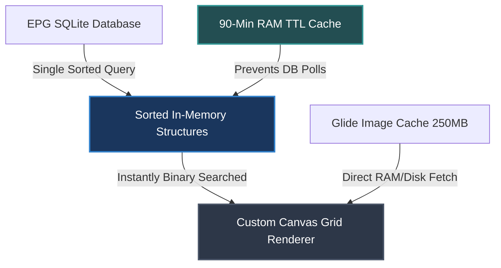
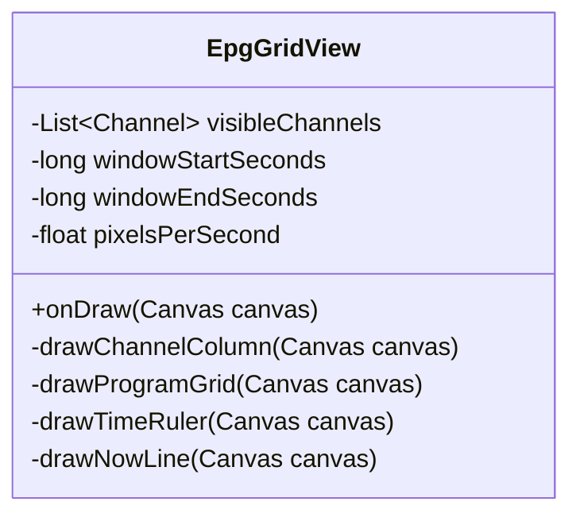

# TiViMate Guide — Complete Technical & Performance Analysis

This document provides a deep-dive architectural analysis of **TiViMate’s Electronic Program Guide (EPG)** performance and caching strategies. It details *why* the interface achieves liquid-smooth 60fps scrolling over thousands of channels and outlines a concrete blueprint for implementing these patterns in **PureFusionIPTV**.

---

## 1. WHY IS TIVIMATE SO FAST? (THE 3 PILLARS)

TiViMate's performance does not come from a single optimization, but rather from three interlocking architectural decisions that completely eliminate the standard bottlenecks of mobile EPG rendering:



1. **Zero Database I/O During Scroll (Load-Once, Sort-Once)**
   The guide loads all EPG data for the active window into a single sorted, in-memory structure at startup. When the user scrolls vertically or horizontally, the UI never polls SQLite. Instead, it binary-searches the in-memory cache.
2. **Direct Pixel Drawing (Custom Canvas Renderer)**
   The EPG grid is **not** a `RecyclerView`. TiViMate bypasses the entire Android View system and draws the EPG grid directly onto a hardware-accelerated `SurfaceView`/`Canvas` layout. This eliminates layout-inflation passes, viewholder recycling overhead, and vertical-horizontal nested scroll synchronization.
3. **Aggressive Multi-Tier Caching**
   EPG text data is cached in RAM for 90 minutes. Channel logos are aggressively handled through a custom Glide disk configuration (250MB LRU). Network and disk are entirely decoupled from the render loop.

---

## 2. DATA ARCHITECTURE & SCHEMA

### The Two-Table EPG Separation
TiViMate optimizes database performance by storing internally-managed EPG data separately from externally-loaded XMLTV EPG data.

| Table | Purpose | Main Time Columns | Indexing |
|---|---|---|---|
| `my_programs` | EPG embedded inside playlists (e.g., Xtream/M3U) | `program_start_seconds`, `program_stop_seconds` | Channel ID + Start Time |
| `tvg_programs` | External XMLTV/EPG files loaded via URL/Path | `start_epoch_seconds`, `stop_epoch_seconds` | tvg_channel_id + Start Epoch |

> [!IMPORTANT]
> **Storage Optimization (Seconds vs. Milliseconds)**
> Both tables store timestamps as **Unix Epoch Seconds (INTEGER)** rather than Milliseconds. This halves the byte size of index columns in SQLite, leading to significantly faster index-seek operations and smaller database files on disk. The UI multiplies these values by `1000L` on-the-fly during rendering.

### The Master EPG Query
To populate the guide without per-channel lazy loading, TiViMate runs a single, highly optimized query that pulls channel details, custom labels, logo metadata, catch-up rules, and EPG bindings in a single execution:

```sql
SELECT 
  m.id, 
  m.channel_id, 
  c.name AS channel_name, 
  c.custom_name AS custom_channel_name,
  length(c.logo) AS channel_logo_from_playlist_length,
  length(t.icon_url) AS channel_logo_from_tvg_length,
  p.logos_priority AS channel_logos_priority, 
  b.tvg_channel_id, 
  m.program_start_seconds, 
  m.program_stop_seconds,
  m.program_title, 
  p.catchup_type AS playlist_catchup_type, 
  p.catchup_hours AS playlist_catchup_hours,
  p.user_catchup_type AS playlist_user_catchup_type, 
  p.user_catchup_hours AS playlist_user_catchup_hours, 
  c.catchup_hours
FROM my_programs m
LEFT OUTER JOIN channels c ON m.channel_id == c.id
LEFT OUTER JOIN playlists p ON c.playlist_id == p.id
LEFT OUTER JOIN channel_tvg_bindings b ON c.id == b.channel_id
LEFT OUTER JOIN tvg_channels t ON b.tvg_channel_id == t.id
WHERE p.is_enabled == 1 
  AND c.deleted_time IS NULL
ORDER BY m.program_start_seconds
```

#### Why this is exceptionally fast:
* **No Blobs in Join**: By utilizing `length(c.logo)` and `length(t.icon_url)` rather than retrieving the actual text or binary logo data during the join, the database keeps rows narrow, allowing SQLite to fetch rows in memory-page bounds.
* **Sorted on Output**: Sorting by `program_start_seconds` prepares the resulting stream for a single-pass linear population into the in-memory arrays.

### Full-Text Search (FTS) Integration
To enable instant search inside the TV guide without slowing down database reads, EPG program names are mirrored in a virtual FTS4 table `tvg_programs_fts`.

```sql
SELECT * FROM tvg_programs
INNER JOIN tvg_programs_fts ON tvg_programs.id == tvg_programs_fts.docid
WHERE tvg_programs_fts.title MATCH ? AND start_epoch_seconds >= ?
LIMIT 10000
```
This isolates complex wildcard string-matching from the main transactional database tables.

---

## 3. THREE-LAYER CACHE ARCHITECTURE

```
[ External Network or XMLTV File Source ]
                   │
                   ▼ (Background WorkManager parsing)
       ┌────────────────────────┐
       │   SQLite Room DB       │   <-- TvPlayer.db (busy_timeout = 3000ms)
       └────────────────────────┘
                   │
                   ▼ (Loaded once at guide launch)
       ┌────────────────────────┐
       │ 90-Min RAM Data Cache  │   <-- LinkedHashMap in-memory (TTL 90m)
       └────────────────────────┘
                   │
                   ▼ (Instant access for graphics)
       ┌────────────────────────┐
       │ Glide Logo Disk Cache  │   <-- 250 MB LRU cache for logo files
       └────────────────────────┘
```

### Layer 1: In-Memory EPG Cache (RAM)
* **TTL**: 90 Minutes (`5,400,000` ms)
* **Implementation**: Structured as a `LinkedHashMap` keyed by Channel ID.
* **Behavior**: When the TV guide is opened, the app checks if the current time is within 90 minutes of the last database sync. If true, it binds directly to the active RAM mapping.

### Layer 2: Glide Logo Disk Cache (Disk)
* **Size**: 250 Megabytes (`262,144,000` bytes)
* **Implementation**: Custom `DiskCache` factory registered in Glide configuration.
* **Behavior**: Logos are stored in an LRU format on-disk. This ensures that no logo is ever downloaded over the network twice during standard scrolling behavior.

### Layer 3: SQLite Busy Timeout Cooldown
* **Timeout**: 3,000 ms
* **Behavior**: EPG updates run heavily in the background. To prevent DB locks from throwing immediate crashes or UI freezes, SQLite is configured with a 3-second busy timeout. If locked, the read query waits for the write transaction to conclude.
* **Error Backoff**: If SQLite encounters a catastrophic database opening error, the app registers a 1-hour (`3,600,000` ms) blackout cooldown. It blocks subsequent query executions to prevent database thrashing and save battery life.

---

## 4. THE CUSTOM CANVAS RENDERING ENGINE

### Why RecyclerView Fails for EPG Grids
Standard `RecyclerView` approaches struggle with 2D grid television guides because:
1. **Vertical/Horizontal Sync**: Binding horizontal rows inside a vertical list causes jagged scroll synchronization.
2. **Layout Inflation**: Inflating views for dozens of small program blocks during fast scrolls creates noticeable garbage collection spikes and micro-stutters.
3. **Item Spanning**: Overlapping cells with varying durations requires complex layout calculations that must run on the main UI thread.

### The TiViMate Alternative: Custom `SurfaceView` / Canvas
TiViMate circumvents this by using a custom hardware-accelerated Canvas renderer:



* **Dynamic Rect Computation**: During vertical and horizontal scrolls, `EpgGridView` recalculates the visible time viewport (`windowStartSeconds` to `windowEndSeconds`).
* **Binary Search**: For each visible channel, the engine binary-searches the channel's program list (already sorted in-memory) to locate only the programs that intersect the active time window.
* **Direct Drawing**: Cells are drawn directly via pixel calculations:
  $$\text{startX} = (\text{programStartSeconds} - \text{windowStartSeconds}) \times \text{pixelsPerSecond}$$
  $$\text{width} = (\text{programStopSeconds} - \text{programStartSeconds}) \times \text{pixelsPerSecond}$$
* **No Off-Screen Allocations**: Cells that fall outside the viewport are ignored entirely, meaning the UI overhead is strictly constant ($O(1)$ relative to total EPG size).

---

## 5. EPG TIME ZONE & UPDATE INFRASTRUCTURE

### Tri-Layer Time Offset Calculation
To ensure that EPG times match local display offsets correctly, TiViMate stacks three separate timezone correction layers before rendering:

1. **`tvg_shift`** (Playlist Level): The default hour offset defined inside the M3U or playlist metadata.
2. **`server_timezone`** (Server Level): The timezone mapping returned by the API provider.
3. **User Manual Offset** (UI Level): A manual hour/minute slider in the settings screen.

All values are converted into Unix Epoch Seconds before matching and storing in `my_programs` or `tvg_programs`.

### Background Worker & Partial Scanning
* **Worker System**: Managed via Android **WorkManager** (`ListenableWorker`), allowing update tasks to run under specific constraints (e.g., when connected to Wi-Fi, charging, or during idle hours).
* **Speed Secret (Partial Scanning)**: Instead of parsing a complete multi-gigabyte XMLTV file sequentially, TiViMate reads the `<channel>` list from the XML file first. It matches these IDs against the local `channels` table in SQLite. It **only** parses `<programme>` tags for channels that are active and not marked as deleted in the playlist. This reduces EPG parsing overhead by up to 90%.

---

## 6. BLUEPRINT: REPLICATING THIS IN PUREFUSIONIPTV

To bring TiViMate-level speed and fluidity to the **PureFusionIPTV** project, the following architectural steps should be implemented.

### Step 1: SQLite Time & Performance Tuning
* **Change Schema**: Ensure all EPG start and end columns are structured as `INTEGER` (Unix Epoch Seconds, not milliseconds).
* **Indices**: Create composite indices on key query patterns:
  ```sql
  CREATE INDEX IF NOT EXISTS idx_my_programs_channel_time ON my_programs (channel_id, program_start_seconds);
  CREATE INDEX IF NOT EXISTS idx_tvg_programs_channel_time ON tvg_programs (tvg_channel_id, start_epoch_seconds);
  ```
* **Busy Timeout**: Ensure your database builder applies a busy timeout:
  ```kotlin
  Room.databaseBuilder(context, AppDatabase::class.java, "PureFusionIPTV.db")
      .setJournalMode(RoomDatabase.JournalMode.WRITE_AHEAD_LOGGING)
      .addCallback(object : RoomDatabase.Callback() {
          override fun onOpen(db: SupportSQLiteDatabase) {
              db.execSQL("PRAGMA busy_timeout = 3000;")
          }
      })
      .build()
  ```

### Step 2: Implement the In-Memory Data Structure
When the guide screen launches, load the active EPG scope into a RAM structure structured for direct access:

```kotlin
class EpgMemoryCache {
    // Key: Channel ID, Value: Sorted List of Programs
    private val programMap = LinkedHashMap<Long, List<Program>>()
    private var lastLoadTimeMs: Long = 0

    fun initialize(channels: List<Channel>, programs: List<Program>) {
        programMap.clear()
        // Sort programs by start time and group by channel
        val grouped = programs.sortedBy { it.startTimeSeconds }
                              .groupBy { it.channelId }
        programMap.putAll(grouped)
        lastLoadTimeMs = System.currentTimeMillis()
    }

    fun getProgramsForChannel(channelId: Long): List<Program>? {
        return programMap[channelId]
    }

    fun isCacheValid(): Boolean {
        // 90 minutes TTL
        return (System.currentTimeMillis() - lastLoadTimeMs) < 90 * 60 * 1000
    }
}
```

### Step 3: Shift from RecyclerView to Custom Drawing
Create a custom `View` that manages the coordinates of the cells directly. 

```kotlin
class EpgCanvasView @JvmOverloads constructor(
    context: Context, attrs: AttributeSet? = null, defStyleAttr: Int = 0
) : View(context, attrs, defStyleAttr) {

    private val textPaint = Paint(Paint.ANTI_ALIAS_FLAG).apply {
        color = Color.WHITE
        textSize = 14f.dpToPx()
    }
    
    private val backgroundPaint = Paint().apply {
        color = Color.parseColor("#1E293B") // Premium dark Slate
    }

    private var viewWindowStartSeconds: Long = System.currentTimeMillis() / 1000
    private var pixelsPerSecond: Float = 0.05f // Adjustable scale

    override fun onDraw(canvas: Canvas) {
        super.onDraw(canvas)
        if (isInEditMode) return

        // 1. Draw Channel Column
        // 2. Iterate through visible channels
        // 3. For each channel, find intersecting programs using binary search:
        val visiblePrograms = findProgramsInWindow(channelId, viewWindowStartSeconds, viewWindowEndSeconds)
        
        for (program in visiblePrograms) {
            val startX = (program.startTime - viewWindowStartSeconds) * pixelsPerSecond
            val endX = (program.endTime - viewWindowStartSeconds) * pixelsPerSecond
            
            // Draw background cell
            canvas.drawRect(startX, rowY, endX, rowY + rowHeight, backgroundPaint)
            
            // Draw text with clip bounds to prevent text overflow
            canvas.save()
            canvas.clipRect(startX + padding, rowY, endX - padding, rowY + rowHeight)
            canvas.drawText(program.title, startX + padding, rowY + textBaseline, textPaint)
            canvas.restore()
        }
    }
}
```

### Step 4: Glide Configuration Tuning
Configure your Glide client in `PureFusionIPTV` to allocate a dedicated, large disk space block specifically for channel logos.

```kotlin
@GlideModule
class PureFusionGlideModule : AppGlideModule() {
    override fun applyOptions(context: Context, builder: GlideBuilder) {
        val diskCacheSizeBytes = 262144000L // 250 MB
        builder.setDiskCache(
            InternalCacheDiskCacheFactory(context, "logo_cache", diskCacheSizeBytes)
        )
    }
}
```

---

## 7. COMPARATIVE RECAP

| Feature | standard approach | TiViMate Approach (PureFusion Goal) |
|---|---|---|
| **Render Element** | Nested RecyclerViews | Single custom `View` drawing directly on `Canvas` |
| **Database Reading** | Paginated / Lazy-loaded from DB on scroll | Single sorted fetch on load, then 100% RAM reads |
| **Time Format** | Milliseconds (`Long`) | Epoch Seconds (`Int`) — half size in DB indices |
| **XMLTV Loading** | Full file sequential parsing | Partial parsing matching only active channel bindings |
| **Image Caching** | Standard 50MB default cache | Targeted 250MB Glide Cache + placeholder loading |
| **UI Stutter** | High (caused by view recycling/layout passes) | Extremely Low (drawing calculated pixels in hardware Canvas) |

By implementing these proven paradigms, **PureFusionIPTV** can bypass the standard performance traps of IPTV guides and deliver an interface that matches the world-class scrolling speeds of TiViMate.
