# TiViMate PVR & Recording (DVR) — Technical Architecture Analysis

This document provides a highly detailed architectural analysis of **TiViMate’s PVR (Personal Video Recorder) / DVR** recording engine. It dissects how the application manages background recording schedules, secures uninterrupted writes during TV sleep states, recovers from stream drops, and integrates recordings with both local storage and network (SMB) shares. It includes concrete blueprints to replicate this robust system in **PureFusionIPTV**.

---

## 1. USER-FLOW LEVEL BEHAVIOR

* **Instant / Direct Recording**: While watching a live stream, the user can press D-pad Center to summon the Quick Actions overlay and click **Record**. The recording begins instantly. A glowing red dot appears on the EPG channel row and inside the Channel Bar overlay.
* **EPG-Scheduled Recording**: The user can browse the TV Guide, select a future program, and click **Record**. The app schedules the task. When the program's start time arrives, the recording starts automatically in the background even if the user is watching another channel, the app is closed, or the TV is in standby/sleep.
* **Repeat Rules**: The user can schedule recurring recordings (e.g., "Record every day at this time" or "Record every Monday").
* **Unified Recordings Catalog**: Scheduled, active, and completed recordings are displayed in a dedicated UI category. Users can resume watching completed files or play active recordings from the beginning (Time-shifting) while they are still being written.

---

## 2. ARCHITECTURAL PATTERNS UNDER THE HOOD

To record live IPTV streams reliably on restricted Android TV hardware, TiViMate decouples stream recording from video playback and operates as a resilient, database-backed background process.

```mermaid
sequenceDiagram
    autonumber
    participant UI as TV UI / EPG
    participant DB as SQLite DB
    participant Alarm as AlarmManager (OS)
    participant RecSvc as RecordingForegroundService
    participant Stream as Live Stream URL
    participant Storage as SMB Share / Local File

    UI->>DB: Schedule program (Insert recording state = SCHEDULED)
    DB-->>UI: Commit transaction
    UI->>Alarm: Set exact alarm (setExactAndAllowWhileIdle)
    Note over Alarm: TV goes to sleep / Screen off
    
    Alarm->>RecSvc: Trigger Broadcast (BroadcastReceiver)
    RecSvc->>RecSvc: Acquire WakeLock & CPU Lock
    RecSvc->>DB: Query recording parameters (State -> RECORDING)
    
    rect rgb(20, 32, 48)
        Note right of RecSvc: Streaming File Pipe
        RecSvc->>Stream: Open raw HTTP TS stream / HLS segmenter
        RecSvc->>Storage: Pipe input stream bytes to file (BufferedOutputStream)
    end
    
    Note over RecSvc: Program finishes or User stops
    RecSvc->>DB: Commit record (State -> COMPLETED)
    RecSvc->>RecSvc: Release WakeLock & Stop Foreground
```



### The 4 Pillars of Resilient Recording

1. **Database-Driven Schedule Manager**:
   The `recordings` SQLite table holds the complete state machine of all PVR records. Work is never scheduled as unpersisted in-memory variables. If the Android OS kills the process, the background service queries the database on reboot to recover schedules.
2. **Foreground Service with WakeLocks**:
   Standard background tasks are aggressively killed on Android TV devices. TiViMate executes active recordings inside a **Foreground Service** (`ar.tvplayer.core.pvr.PvrService`) holding a CPU WakeLock (`PowerManager.PARTIAL_WAKE_LOCK`). This ensures the CPU continues downloading stream packets even if the TV panel is turned off via remote control (CEC Standby).
3. **Raw Transport Stream (TS) Piping**:
   Instead of decoding and re-encoding video frames (which would vaporize TV hardware resources), TiViMate performs a highly efficient **direct file dump** of the incoming HTTP TS (Transport Stream). It streams packets directly from network sockets to disk using a buffered I/O stream, requiring under 2% CPU usage.
4. **Stream Watchdog & Chunk Recovery**:
   IPTV streams suffer from high disconnect rates. The PVR parser incorporates a **watchdog timer**. If 0 bytes are received for a threshold (e.g., 5 seconds), it kills the current socket, retrieves the stream URL from database, re-authenticates, and appends incoming packets back onto the same file, preventing fragmented output.

---

## 3. CLUE SOURCE (CLASSES & FILES)

* **`sources/p240/C3214.java`** (Recording data access interface):
  * **Case 19 (Check existing file recordings)**:
    ```sql
    SELECT id, file_path 
    FROM recordings 
    WHERE status == 3 AND file_path LIKE ? || '%'
    ```
    Status `3` represents **COMPLETED** or **ACTIVE** recordings, matching directory structures to let the file picker index finished streams.
  * **Case 20 (Push Recording Payload to Remote System)**:
    Loads full program details from the SQLite database to sync records with scheduled alarm systems. It binds columns directly into a Kotlin-friendly data transfer model (`RecordingForPush`):
    ```sql
    SELECT r.start_seconds, r.stop_seconds, r.file_path, c.playlist_id, 
           c.xc_id channel_xc_id, c.url channel_url, r.original_channel_name, 
           r.program_start_seconds, r.program_stop_seconds, r.program_title, 
           r.program_desc, r.custom_recording_name, r.repeat_rules
    FROM recordings r
    LEFT OUTER JOIN channels c ON r.channel_id == c.id
    WHERE c.deleted_time IS NULL
        AND r.status == 3
        AND r.file_path LIKE ? || '%'
    ```
* **`sources/p240/C3220.java`** (PVR path resolution updates):
  * **Case 10 (Dynamic file path updating)**:
    ```sql
    UPDATE recordings SET file_path = ? WHERE id == ?
    ```
    This is called when an active recording is dynamically redirected (e.g., if a local drive runs out of space and fallback storage is mounted, or when migrating a temp recording file to its permanent destination).
* **`sources/androidx/lifecycle/C0185.java`** (Repeat Rules & Schedules Parser):
  * Parses complex repeat schedules (e.g. daily, weekly arrays) saved as serialized strings in SQLite using standard Room custom converters (`RecordingRepeatRules` type converters).

---

## 4. CONCEPTUAL REPLICATIONS FOR PUREFUSIONIPTV

To implement a bulletproof PVR recording subsystem in **PureFusionIPTV**, use the following structural blueprint.

### Step 1: SQLite/Room Database Entity Schema

Define a clean Room entity supporting both local and SMB target shares with exact Unix Epoch timestamps (in seconds).

```kotlin
@Entity(
    tableName = "recordings",
    foreignKeys = [
        ForeignKey(
            entity = ChannelEntity::class,
            parentColumns = ["id"],
            childColumns = ["channel_id"],
            onDelete = ForeignKey.SET_NULL
        )
    ]
)
data class RecordingEntity(
    @PrimaryKey(autoGenerate = true) val id: Long = 0,
    @ColumnInfo(name = "channel_id") val channelId: Long?,
    @ColumnInfo(name = "start_seconds") val startSeconds: Long,
    @ColumnInfo(name = "stop_seconds") val stopSeconds: Long,
    @ColumnInfo(name = "file_path") val filePath: String,
    @ColumnInfo(name = "original_channel_name") val originalChannelName: String,
    @ColumnInfo(name = "program_title") val programTitle: String,
    @ColumnInfo(name = "program_desc") val programDesc: String?,
    @ColumnInfo(name = "status") val status: Int, // 0: SCHEDULED, 1: RECORDING, 2: COMPLETED, 3: FAILED
    @ColumnInfo(name = "repeat_rules") val repeatRules: String? // Serialized repeat JSON
)
```

### Step 2: The Direct Stream Piping Engine

Write a memory-safe stream pipe inside a background Coroutine context that pulls raw TS bytes and writes them to a file (supporting SMB network shares seamlessly using SMBJ).

```kotlin
class StreamRecordingPipe(
    private val client: OkHttpClient,
    private val bufferSize: Int = 128 * 1024 // 128KB buffer
) {
    suspend fun recordStream(
        streamUrl: String, 
        outputFile: File, 
        stopTimeSeconds: Long,
        onProgress: (bytesWritten: Long) -> Unit
    ) = withContext(Dispatchers.IO) {
        val request = Request.Builder().url(streamUrl).build()
        var bytesWritten = 0L

        try {
            client.newCall(request).execute().use { response ->
                if (!response.isSuccessful) throw IOException("Failed to connect: $response")
                
                val inputStream = response.body?.byteStream() ?: throw IOException("Empty stream body")
                outputFile.parentFile?.mkdirs()
                
                FileOutputStream(outputFile, true).use { fileOut ->
                    BufferedOutputStream(fileOut, bufferSize).use { bufferedOut ->
                        val buffer = ByteArray(bufferSize)
                        var bytesRead: Int
                        
                        while (System.currentTimeMillis() / 1000 < stopTimeSeconds) {
                            // Non-blocking read check or timeout loop
                            bytesRead = inputStream.read(buffer)
                            if (bytesRead == -1) break // End of stream
                            
                            bufferedOut.write(buffer, 0, bytesRead)
                            bytesWritten += bytesRead
                            onProgress(bytesWritten)
                        }
                        bufferedOut.flush()
                    }
                }
            }
        } catch (e: Exception) {
            Log.e("PvrPipe", "Stream piping exception, attempting reconnection", e)
            throw e // Let the foreground service handle retries
        }
    }
}
```

### Step 3: Reliable Foreground Service Execution

Register a foreground service with a `PARTIAL_WAKE_LOCK` to ensure the OS never puts the CPU to sleep during active writes.

```kotlin
class PvrForegroundService : Service() {
    private var wakeLock: PowerManager.WakeLock? = null
    
    override fun onCreate() {
        super.onCreate()
        val powerManager = getSystemService(Context.POWER_SERVICE) as PowerManager
        wakeLock = powerManager.newWakeLock(PowerManager.PARTIAL_WAKE_LOCK, "PureFusion::PvrWakeLock").apply {
            acquire(120 * 60 * 1000L) // Fail-safe 2 hour absolute timeout
        }
        
        startForeground(NOTIFICATION_ID, createNotification())
    }

    override fun onDestroy() {
        wakeLock?.let {
            if (it.isHeld) it.release()
        }
        super.onDestroy()
    }

    override fun onBind(intent: Intent?): IBinder? = null
    
    private fun createNotification(): Notification {
        // Build premium, non-obtrusive dark notification indicating "Recording live..."
        return NotificationCompat.Builder(this, CHANNEL_ID)
            .setContentTitle("Recording Live Channel")
            .setContentText("Saving feed directly to your PVR library...")
            .setSmallIcon(R.drawable.ic_record_glowing)
            .setColor(Color.parseColor("#EF4444")) // Red status highlight
            .build()
    }
}
```

---

## 5. DIRECT COPYING WARNINGS (DO NOT COPY)

* **`ar.tvplayer.core.data.db.entities.RecordingForPush`**: Do not import this class or its packages. It is an internal obfuscated representation of compiled data structures specific to TiViMate's IPC and push notification wrappers.
* **Obfuscated Status Constants**: Do not use raw magic numbers (e.g. `status == 3`) directly in queries without declaring a clean Kotlin Enum (e.g., `RecordingStatus.COMPLETED`). This avoids breaking schema changes and keeps database triggers highly readable.

---

## 6. IMPLEMENTATION RISKS

* **Network SMB Storage Drops**:
  Network environments are inherently unstable. Writing raw TS streams straight to an SMB network share will crash the write loop if Wi-Fi stutters for even a fraction of a second.
  * *Mitigation*: **Double Buffering**. Always download the stream to a temporary local cache folder (e.g. internal storage `/cache/pvr/`) and upload/stream blocks to SMB shares asynchronously using a background queue buffer.
* **Storage Exhaustion Panic**:
  HD IPTV feeds consume roughly **2GB to 4GB of disk space per hour**. If a 4-hour scheduled recording runs out of storage, it can cause the entire Android system storage to lock up or force-close the app.
  * *Mitigation*: Implement a **storage supervisor thread** that checks available disk space every 30 seconds. If free storage falls below 500MB, the service must gracefully stop the recording, update database status to `COMPLETED_LOW_SPACE`, and trigger a local notification.
* **Timeline Time Drifts**:
  IPTV stream providers frequently deviate from standardized EPG timelines. A program scheduled to finish at 8:00 PM might run until 8:05 PM, truncating the end of the recording.
  * *Mitigation*: **Padding Margins**. Always configure the recording scheduler with customizable padding values (e.g., Start 2 minutes early, End 5 minutes late).
