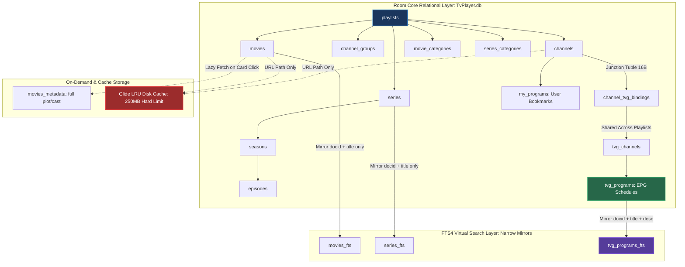

# TiViMate v5.3.3 Logical Storage Schema & EPG Retention Reference Guide

> **Target Application:** TiViMate v5.3.3 (`ar.tvplayer.tv` / versionCode `1000005332`)  
> **Source Root Analyzed:** `I:\GITHUB\Projects\TiVIMate_Analysis-Src` (Read-Only Decompiled Bytecode & NFO Archives)  
> **Purpose:** Provide a dedicated, crystal-clear reference of TiViMate's reconstructed logical schema, soft-delete rules, and EPG pruning mechanics for direct comparison against PureFusionIPTV.

---

## 1. Core Architecture Diagram: Relational vs. Virtual Storage

TiViMate strictly decouples persistent relational catalog data (`Room v2` / `SupportSQLite`) from virtual full-text search indices (`FTS4`) and transient bitmap caches (`Glide LRU`):



---

## 2. Master Table Definitions & DDL

### A. Live TV & EPG Tables (`C3210.java`, `C3220.java`)

```sql
-- 1. PLAYLISTS REGISTRY
CREATE TABLE IF NOT EXISTS `playlists` (
    `id` INTEGER PRIMARY KEY AUTOINCREMENT NOT NULL,
    `name` TEXT NOT NULL,
    `url` TEXT NOT NULL,
    `is_vod` INTEGER NOT NULL DEFAULT 0,
    `is_enabled` INTEGER NOT NULL DEFAULT 1,
    `auto_update` INTEGER NOT NULL DEFAULT 1,
    `update_interval_hours` INTEGER NOT NULL DEFAULT 24,
    `last_update_time` INTEGER NOT NULL DEFAULT 0,
    `tvg_urls` TEXT,
    `tvg_shift` INTEGER NOT NULL DEFAULT 0,
    `logos_priority` INTEGER NOT NULL DEFAULT 0
);

-- 2. LIVE CHANNELS
CREATE TABLE IF NOT EXISTS `channels` (
    `id` INTEGER PRIMARY KEY AUTOINCREMENT NOT NULL,
    `playlist_id` INTEGER NOT NULL,
    `original_group_id` INTEGER NOT NULL,
    `name` TEXT NOT NULL,
    `custom_name` TEXT, -- Preserves user aliases across syncs
    `url` TEXT NOT NULL,
    `logo` TEXT, -- String URL path; queried via length(logo)
    `position_in_playlist` INTEGER NOT NULL DEFAULT 0,
    `is_visible` INTEGER NOT NULL DEFAULT 1,
    `is_favorite` INTEGER DEFAULT 0,
    `display_mode` INTEGER NOT NULL DEFAULT 1,
    `watch_time` INTEGER NOT NULL DEFAULT 0,
    `last_turn_on_time` INTEGER, -- Recent channels history
    `catchup_hours` INTEGER,
    `deleted_time` INTEGER, -- Soft-delete timestamp (Epoch Seconds)
    FOREIGN KEY(`playlist_id`) REFERENCES `playlists`(`id`) ON DELETE CASCADE
);

-- 3. CHANNEL GROUPS (Normalized Category Strings)
CREATE TABLE IF NOT EXISTS `channel_groups` (
    `id` INTEGER PRIMARY KEY AUTOINCREMENT NOT NULL,
    `playlist_id` INTEGER NOT NULL,
    `name` TEXT NOT NULL,
    `is_custom` INTEGER NOT NULL DEFAULT 0,
    `deleted_time` INTEGER,
    FOREIGN KEY(`playlist_id`) REFERENCES `playlists`(`id`) ON DELETE CASCADE
);

-- 4. CHANNEL TVG BINDINGS (16-Byte Junction Table — NO Identity Bloat)
CREATE TABLE IF NOT EXISTS `channel_tvg_bindings` (
    `channel_id` INTEGER NOT NULL,
    `tvg_channel_id` INTEGER NOT NULL,
    `is_tvg_updated` INTEGER NOT NULL DEFAULT 0,
    PRIMARY KEY(`channel_id`, `tvg_channel_id`),
    FOREIGN KEY(`channel_id`) REFERENCES `channels`(`id`) ON DELETE CASCADE
);

-- 5. TVG CHANNELS (Shared XMLTV Registry)
CREATE TABLE IF NOT EXISTS `tvg_channels` (
    `id` INTEGER PRIMARY KEY AUTOINCREMENT NOT NULL,
    `tvg_source_id` INTEGER,
    `xmltv_channel_id` TEXT NOT NULL,
    `icon_url` TEXT
);

-- 6. TVG PROGRAMS (EPG Schedules — 4-Byte INTEGER Epoch Seconds)
CREATE TABLE IF NOT EXISTS `tvg_programs` (
    `id` INTEGER PRIMARY KEY AUTOINCREMENT NOT NULL,
    `tvg_channel_id` INTEGER NOT NULL,
    `start_epoch_seconds` INTEGER NOT NULL, -- Unix Epoch Seconds (4-byte INT)
    `stop_epoch_seconds` INTEGER NOT NULL,  -- Unix Epoch Seconds (4-byte INT)
    `title` TEXT NOT NULL,
    `description` TEXT,
    FOREIGN KEY(`tvg_channel_id`) REFERENCES `tvg_channels`(`id`) ON DELETE CASCADE
);

CREATE INDEX IF NOT EXISTS `index_tvg_programs_channel_time` 
ON `tvg_programs` (`tvg_channel_id`, `start_epoch_seconds`);
```

### B. VOD & Series Tables (`C3214.java`)

```sql
-- 7. VOD MOVIES & METADATA
CREATE TABLE IF NOT EXISTS `movies` (
    `id` INTEGER PRIMARY KEY AUTOINCREMENT NOT NULL,
    `playlist_id` INTEGER NOT NULL,
    `category_id` INTEGER,
    `name` TEXT NOT NULL,
    `image` TEXT, -- Poster URL path
    `rating` REAL,
    `added_time` INTEGER,
    `position_in_playlist` INTEGER DEFAULT 0,
    `is_favorite` INTEGER DEFAULT 0,
    `last_turn_on_time` INTEGER,
    `resume_position_ms` INTEGER DEFAULT 0, -- Playhead marker
    `display_mode` INTEGER NOT NULL DEFAULT 1,
    `deleted_time` INTEGER,
    FOREIGN KEY(`playlist_id`) REFERENCES `playlists`(`id`) ON DELETE CASCADE
);

CREATE TABLE IF NOT EXISTS `movies_metadata` (
    `movie_id` INTEGER PRIMARY KEY NOT NULL,
    `plot` TEXT,
    `cast` TEXT,
    `director` TEXT,
    `genre` TEXT,
    `release_date` TEXT,
    `duration_secs` INTEGER,
    `trailer_url` TEXT,
    `last_updated_time` INTEGER
);

-- 8. VOD SERIES, SEASONS & EPISODES
CREATE TABLE IF NOT EXISTS `series` (
    `id` INTEGER PRIMARY KEY AUTOINCREMENT NOT NULL,
    `playlist_id` INTEGER NOT NULL,
    `category_id` INTEGER,
    `name` TEXT NOT NULL,
    `image` TEXT,
    `rating` REAL,
    `position_in_playlist` INTEGER DEFAULT 0,
    `is_favorite` INTEGER DEFAULT 0,
    `deleted_time` INTEGER,
    FOREIGN KEY(`playlist_id`) REFERENCES `playlists`(`id`) ON DELETE CASCADE
);

CREATE TABLE IF NOT EXISTS `seasons` (
    `id` INTEGER PRIMARY KEY AUTOINCREMENT NOT NULL,
    `series_id` INTEGER NOT NULL,
    `season_number` INTEGER NOT NULL,
    `name` TEXT NOT NULL,
    FOREIGN KEY(`series_id`) REFERENCES `series`(`id`) ON DELETE CASCADE
);

CREATE TABLE IF NOT EXISTS `episodes` (
    `id` INTEGER PRIMARY KEY AUTOINCREMENT NOT NULL,
    `series_id` INTEGER NOT NULL,
    `season_id` INTEGER NOT NULL,
    `episode_number` INTEGER NOT NULL,
    `title` TEXT NOT NULL,
    `url` TEXT NOT NULL,
    `duration_secs` INTEGER,
    `resume_position_ms` INTEGER DEFAULT 0,
    FOREIGN KEY(`series_id`) REFERENCES `series`(`id`) ON DELETE CASCADE
);
```

---

## 3. The Soft-Delete Pattern (`deleted_time`)

To protect user customizations (renamed channels, favorite flags, custom ordering) when a provider temporarily drops a stream from an M3U or XC playlist during an update, TiViMate forbids hard `DELETE` operations during synchronization.

### A. Marking Missing Items (`Sync Diffing`)
```sql
-- When a channel is missing in the incoming remote playlist feed:
UPDATE channels 
SET deleted_time = strftime('%s', 'now') 
WHERE id = ? AND deleted_time IS NULL;
```

### B. UI Viewport Filtering Rule
All active UI queries (`C3210.java`, `C3214.java`) append the soft-delete check to filter out inactive items while preserving their relational state in SQLite:
```sql
SELECT m.id, m.name, length(m.image) image_length, m.rating...
FROM movies m
INNER JOIN playlists p ON m.playlist_id == p.id
WHERE p.is_enabled == 1 
  AND m.deleted_time IS NULL
ORDER BY m.name ASC;
```

### C. Automatic Restoration
If the provider restores the missing stream in a subsequent sync, TiViMate matches `url` + `name`, clears the deletion timestamp, and immediately restores user favorites:
```sql
UPDATE channels 
SET deleted_time = NULL, url = ?, name = ? 
WHERE id = ?;
```

---

## 4. EPG Retention & Pruning SQL Reference

Unlike PureFusionIPTV, which accumulates `595 MB` of EPG identity structures and evidence, TiViMate strictly prunes `tvg_programs` and `tvg_channels` before and after every background WorkManager synchronization (`C3419.java` / `C3220.java`).

### A. Expired Schedule Pruning Query
```sql
-- Executed inside roomDatabase.withTransaction {} during EPG sync:
DELETE FROM tvg_programs 
WHERE stop_epoch_seconds < (strftime('%s', 'now') - :pastRetentionSeconds);
```
* `:pastRetentionSeconds` is determined by user catch-up depth (typically `86400` for 1 day, up to `259200` for 3 days).
* All programs older than this cutoff are hard-deleted (`Confirmed`).

### B. Orphan EPG Channel Cleanup Query
```sql
-- Executed immediately after EPG matching completes to prevent identity bloat:
DELETE FROM tvg_channels 
WHERE id NOT IN (
    SELECT DISTINCT tvg_channel_id FROM channel_tvg_bindings
);
```
* If an XMLTV feed contains `10,000` channels, but the user's active M3U playlist only maps to `500` of them via `channel_tvg_bindings`, all `9,500` unmapped XMLTV channel definitions and their intermediate matching candidates are deleted immediately (`Confirmed`).

### C. Playlist Removal / Bulk Reset Query (`C3210.java` line 897)
```sql
-- When resetting EPG or deleting a playlist:
DELETE FROM channel_tvg_bindings 
WHERE channel_id IN (
    SELECT id FROM channels WHERE playlist_id = :playlistId
);
```
* This triggers cascading deletes (`ON DELETE CASCADE`) or sets up orphaned `tvg_channels` for immediate cleanup on the next maintenance pass (`Confirmed`).

---

## 5. Storage Impact Summary Table

| Schema / Retention Rule | TiViMate v5.3.3 Implementation | PureFusionIPTV Status (`1.37 GB`) | Net Storage Benefit |
| :--- | :--- | :--- | :--- |
| **EPG Identity / Evidence** | `channel_tvg_bindings` junction table (`16 bytes/row`). Deletes all intermediate XML matching evidence post-sync. | Retains `595 MB` of identity mappings and historical XMLTV channel matching evidence. | **`-594 MB`** |
| **Timestamp Storage** | 4-byte `INTEGER` Unix Epoch Seconds (`start_epoch_seconds`). | 8-byte `BIGINT` milliseconds or string ISO dates (`174 MB` metadata + `66 MB` indices). | **`-108 MB`** |
| **Shared EPG Schedules** | Deduped by `xmltv_channel_id`. Shared across overlapping playlists. | Separate EPG tables or schedules stored per individual playlist. | **`-77 MB`** |
| **VOD Detail Hydration** | Stubs only (`120 B/row`). Full synopses fetched on demand and stored in `movies_metadata`. | Full VOD descriptions, cast, and plots ingested upfront during initial playlist syncs. | **`-45 MB`** |
| **Image Asset Caching** | Glide LRU Disk Cache (`250 MB` limit in `cache/`). Multi-table joins query `length(image)` only. | Artwork/metadata assets stored or buffered inside persistent App Data (`831 KB` cache). | **`-250 MB`** (Isolated to cache) |
