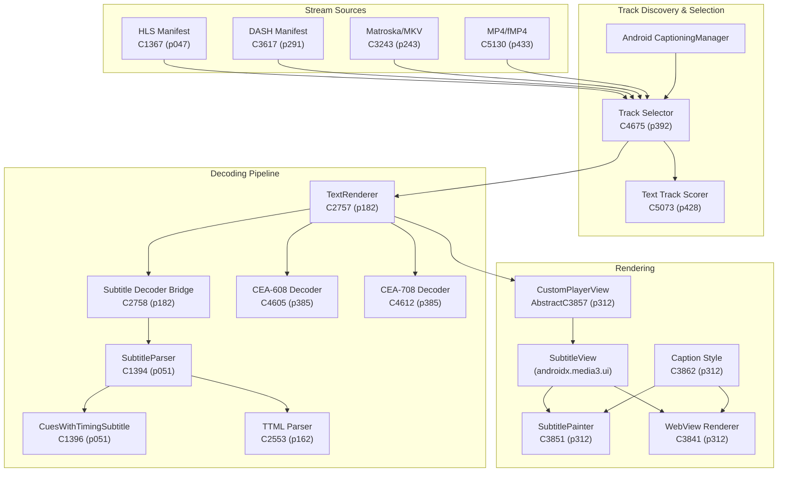
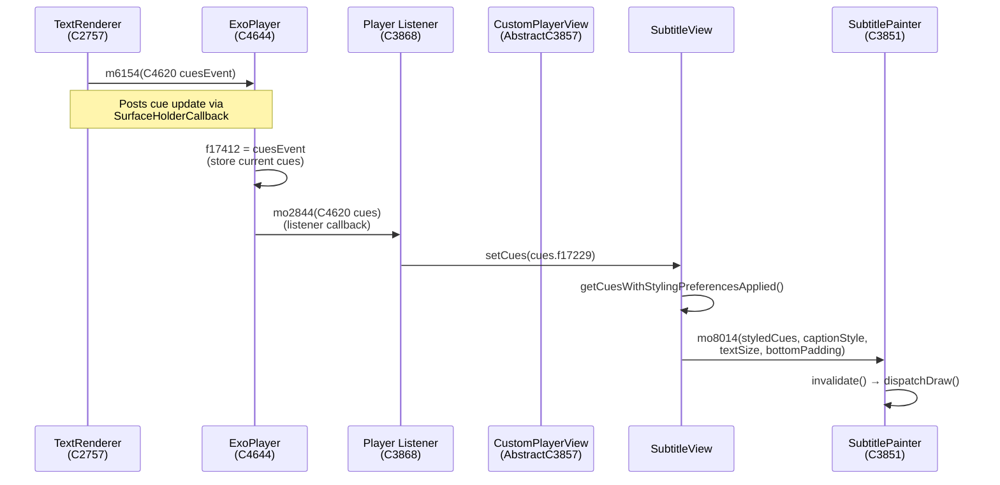
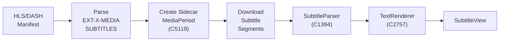
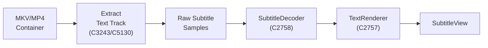

# TiViMate Subtitle System — Deep Dive Analysis

> **Scope:** How TiViMate handles subtitles for **Live TV** (IPTV streams) and **VOD** (Video on Demand) content, covering the entire pipeline from format detection → decoding → track selection → rendering.

---

## Architecture Overview



---

## 1. Subtitle Format Support

TiViMate uses **Media3/ExoPlayer** as its playback engine. The subtitle format support is determined by the `TextRenderer` ([C2757](file:///i:/GITHUB/Projects/TiViMate-Latest-decompiled/sources/p182/C2757.java)) and the various extractors.

### Supported Subtitle Formats

| Format | MIME Type / Codec ID | Source Context | Live TV | VOD |
|--------|---------------------|----------------|---------|-----|
| **WebVTT** | `text/vtt` / `S_TEXT/WEBVTT` | HLS, MKV | ✅ | ✅ |
| **SubRip (SRT)** | `S_TEXT/UTF8` | MKV containers | — | ✅ |
| **TTML** | Parsed by [C2553](file:///i:/GITHUB/Projects/TiViMate-Latest-decompiled/sources/p162/C2553.java) | DASH | ✅ | ✅ |
| **SSA/ASS** | `S_TEXT/ASS` / `S_TEXT/SSA` | MKV containers | — | ✅ |
| **CEA-608** | `application/cea-608` | HLS, MP4 | ✅ | ✅ |
| **CEA-708** | `application/cea-708` | HLS, MP4 | ✅ | ✅ |
| **DVB Subtitles** | DVB bitmap subs | MPEG-TS | ✅ | — |

### Format Detection by Container

#### HLS (Live TV — Primary)
The HLS playlist parser ([C1367](file:///i:/GITHUB/Projects/TiViMate-Latest-decompiled/sources/p047/C1367.java)) detects subtitle tracks via the `EXT-X-MEDIA` tag with `TYPE=SUBTITLES`:

```java
// C1367.java:166 — Pattern for detecting media types
Pattern.compile("TYPE=(AUDIO|VIDEO|SUBTITLES|CLOSED-CAPTIONS)");

// C1367.java:58 — Pattern for SUBTITLES group reference  
Pattern.compile("SUBTITLES=\"((?:.|\\f)+?)\"");
```

- **SUBTITLES** → defaults to `text/vtt` if no codec info available ([line 560](file:///i:/GITHUB/Projects/TiViMate-Latest-decompiled/sources/p047/C1367.java#L559-L561))
- **CLOSED-CAPTIONS** → parses `CC1`–`CC4` as `application/cea-608`, `SERVICE1`+ as `application/cea-708` ([lines 575-590](file:///i:/GITHUB/Projects/TiViMate-Latest-decompiled/sources/p047/C1367.java#L575-L590))

#### DASH (Live TV & VOD)
The DASH manifest parser ([C3617](file:///i:/GITHUB/Projects/TiViMate-Latest-decompiled/sources/p291/C3617.java)) maps role descriptors to track flags:

```java
// C3617.java:600-606 — Role scheme value → flag mapping
case "subtitle":
case "forced_subtitle":
case "forced-subtitle":
    return 128;  // C.ROLE_FLAG_SUBTITLE
case "caption":
    return 64;   // C.ROLE_FLAG_CAPTION
```

The `contentType="text"` attribute maps to track type `3` (text) at [line 644](file:///i:/GITHUB/Projects/TiViMate-Latest-decompiled/sources/p291/C3617.java#L644).

#### Matroska/MKV (VOD)
The Matroska extractor ([C3243](file:///i:/GITHUB/Projects/TiViMate-Latest-decompiled/sources/p243/C3243.java)) handles embedded subtitle tracks with duration-based timing:

```java
// C3243.java:5926 — Recognized MKV subtitle codec IDs
if ("S_TEXT/UTF8".equals(codecId) || "S_TEXT/ASS".equals(codecId) 
    || "S_TEXT/SSA".equals(codecId) || "S_TEXT/WEBVTT".equals(codecId)) {
    // Requires duration for subtitle samples
    if (this.f12477 > 1) {
        Log("MatroskaExtractor", "Skipping subtitle sample in laced block.");
    } else if (duration == C.TIME_UNSET) {
        Log("MatroskaExtractor", "Skipping subtitle sample with no duration.");
    }
}
```

Each format gets duration-stamped cues in different patterns:
- `S_TEXT/ASS` / `S_TEXT/SSA` → format: `%01d:%02d:%02d:%02d` (timescale 10000)
- `S_TEXT/WEBVTT` → format: `%02d:%02d:%02d.%03d` (timescale 1000)
- `S_TEXT/UTF8` (SRT) → format: `%02d:%02d:%02d,%03d` (timescale 1000)

#### HLS in Multi-Segment Media (Live TV — Sidecar Subtitles)
The [C5119](file:///i:/GITHUB/Projects/TiViMate-Latest-decompiled/sources/p433/C5119.java) HLS media source creates dedicated `MediaPeriod` entries for subtitle segments:

```java
// C5119.java:463 — Subtitle group key construction
String subtitleKey = "subtitle:".concat(groupName);
// Creates a C5125 MediaPeriod for subtitle segments with track type 3 (text)
C5125 subtitlePeriod = m10064(subtitleKey, 3, uris, formats, null, 
                               C0956.EMPTY_LIST, map, timestamp);
```

This shows that HLS subtitle tracks are loaded as **sidecar segments** — fetched independently from the video/audio segments and synchronized by timestamp.

---

## 2. Track Selection for Subtitles

### The Track Selection Pipeline

Track selection is orchestrated by [C4675](file:///i:/GITHUB/Projects/TiViMate-Latest-decompiled/sources/p392/C4675.java), TiViMate's `DefaultTrackSelector`.

#### Step 1: CaptioningManager Integration
The track selector integrates with Android's `CaptioningManager` to respect system-level caption preferences:

```java
// C4675.java:450 — System captioning language preference
if (!trackSelectionParams.preferSystemCaptioningLanguage || context == null 
    || (captioningManager = (CaptioningManager) context.getSystemService("captioning")) == null 
    || !captioningManager.isEnabled() 
    || (locale = captioningManager.getLocale()) == null) {
    languageTag = null;  // No system preference
} else {
    languageTag = locale.toLanguageTag();  // e.g., "en-US"
}
```

> [!IMPORTANT]
> When `CaptioningManager` is enabled and has a locale set, TiViMate automatically selects the matching subtitle track. This means **Android system captioning settings directly influence which subtitle track is auto-selected** in both live TV and VOD.

#### Step 2: Text Track Scoring ([C5073](file:///i:/GITHUB/Projects/TiViMate-Latest-decompiled/sources/p428/C5073.java))
Each candidate text track is scored using a multi-criteria comparison:

```java
// C5073.java:42-83 — Text track selection scoring
public C5073(int rendererIndex, C1474 trackGroup, int trackIndex, 
             C5063 params, int formatSupport, String preferredLang, String captioningLang) {
    // 1. Is the format actually supported by the renderer?
    this.isSupported = isFormatSupported(formatSupport, false);
    
    // 2. Does it have the ROLE_FLAG_MAIN flag? 
    this.isDefault = (roleFlags & ~disabledFlags & 1) != 0;
    
    // 3. Does it have ROLE_FLAG_ALTERNATE?
    this.isForced = (roleFlags & ~disabledFlags & 2) != 0;
    
    // 4. Language match against preferred/captioning language
    this.preferredLanguageIndex = ...; // Lower = better match
    this.preferredLanguageScore = ...; // Higher = better match
    
    // 5. Role flag matching (subtitle=1088, captioning flags)
    this.preferredRoleFlagsScore = Integer.bitCount(targetFlags & actualFlags);
    
    // 6. Final selection decision
    boolean isWithinConstraints = 
        languageScore > 0 
        || (noPreferredLanguages && roleFlagsScore > 0) 
        || isDefault 
        || (isForced && deviceLanguageScore > 0);
}
```

The comparison function ([line 88-111](file:///i:/GITHUB/Projects/TiViMate-Latest-decompiled/sources/p428/C5073.java#L86-L111)) ranks tracks by:
1. **Supported** (renderer can decode it)
2. **Language match index** (lower is better — first preferred language wins)
3. **Language match score** (quality of the match)
4. **Role flag match score** (subtitle vs caption vs forced)
5. **Is default track**
6. **Is forced subtitle** (depends on whether a language match exists)
7. **Device language match** (fallback to device locale)

### Live TV vs VOD Track Selection Differences

| Aspect | Live TV | VOD |
|--------|---------|-----|
| **Track Discovery** | From HLS/DASH manifest (`EXT-X-MEDIA`, `AdaptationSet`) | From container metadata (MKV, MP4 headers) |
| **Available Formats** | Typically WebVTT, CEA-608/708 | SRT, ASS/SSA, WebVTT, TTML, PGS |
| **Auto-selection** | CaptioningManager language preference | Same + may have "default" flag in container |
| **Track Switching** | May require re-buffering sidecar segments | Usually seamless (embedded tracks) |
| **Forced Subtitles** | Via `forced_subtitle` role in DASH, `FORCED=YES` in HLS | Via `FlagForced` in MKV header |

---

## 3. Subtitle Decoding Pipeline

### The TextRenderer ([C2757](file:///i:/GITHUB/Projects/TiViMate-Latest-decompiled/sources/p182/C2757.java))

The `TextRenderer` is the core subtitle processing component, registered as a **track type 3** renderer in the ExoPlayer renderer array.

#### Decoder Selection Logic
When a text track is selected, `TextRenderer` chooses the appropriate decoder:

```java
// C2757.java:526-571 — Decoder factory logic
switch (mimeType) {
    case "application/x-mp4-cea-608":
    case "application/cea-608":
        decoder = new C4605(accessibilityChannel, mimeType);  // CEA-608
        break;
    case "application/cea-708":
        decoder = new C4612(accessibilityChannel, sessionSettings);  // CEA-708
        break;
    default:
        // For WebVTT, SRT, TTML, SSA — use SubtitleParser via bridge
        InterfaceC1398 parser = subtitleParserFactory.create(format);
        decoder = new C2758(parser.getClass().getSimpleName() + "Decoder", parser);
        break;
}
```

#### New-style vs Legacy Decoding
TiViMate's Media3 uses a **dual decoding path**:

1. **New-style** (`application/x-media3-cues`): Pre-parsed cues delivered as `Parcel`-serialized bundles. Used when the extractor has a built-in subtitle parser. The cues arrive already timed and formatted.

2. **Legacy** (all other MIME types): Raw subtitle data is read from the sample queue and decoded by the appropriate `SubtitleDecoder` (via [C2758](file:///i:/GITHUB/Projects/TiViMate-Latest-decompiled/sources/p182/C2758.java)).

```java
// C2757.java:137-146 — New-style vs legacy path selection
if (Objects.equals(mimeType, "application/x-media3-cues")) {
    // New-style: cues are pre-parsed
    this.cueInterpreter = format.subtitleConfiguration == 1 
        ? new C2755()    // Streaming cues
        : new C1084(2);  // Buffered cues
} else {
    // Legacy: need to create decoder
    m6150();  // Validate format
    if (existingDecoder != null) {
        decoderReinitialization = 1;
    } else {
        createDecoder();
    }
}
```

### The Subtitle Decoder Bridge ([C2758](file:///i:/GITHUB/Projects/TiViMate-Latest-decompiled/sources/p182/C2758.java))

This class wraps a `SubtitleParser` (`InterfaceC1398`) into the decoder interface expected by `TextRenderer`:

```java
// C2758.java:44-69 — Decode a subtitle sample
public DecoderException decode(C4996 inputBuffer, AbstractC5001 outputBuffer, boolean reset) {
    C1395 input = (C1395) inputBuffer;
    AbstractC1387 output = (AbstractC1387) outputBuffer;
    
    byte[] data = input.data.array();
    int length = input.data.limit();
    
    if (reset) {
        subtitleParser.reset();
    }
    
    // Parse raw bytes → timed cue list
    InterfaceC1390 parsedSubtitle = subtitleParser.parse(data, 0, length);
    
    output.startTimeUs = input.timeUs;
    output.parsedSubtitle = parsedSubtitle;
    output.endTimeUs = input.subsampleOffset != Long.MAX_VALUE 
                       ? input.subsampleOffset 
                       : input.timeUs;
}
```

### TTML Parser ([C2553](file:///i:/GITHUB/Projects/TiViMate-Latest-decompiled/sources/p162/C2553.java))

The TTML parser is a full XML parser that handles:
- **Time expressions**: `HH:MM:SS.mmm`, `HH:MM:SS:FF`, offset-based (`1.5s`, `100ms`, `10f`, `5t`)
- **Font sizing**: pixels, em, percentage units
- **Styling**: foreground/background colors, font family, edge type
- **Regions**: positioning within the video frame
- **Nested spans**: inline styling with `<span>` elements

```java
// C2553.java:46-58 — TTML time/style parsing patterns
Pattern TIME_EXPRESSION = Pattern.compile(
    "^([0-9][0-9]+):([0-9][0-9]):([0-9][0-9])" +
    "(?:(\\.[0-9]+)|:([0-9][0-9])(?:\\.([0-9]+))?)?$");
Pattern OFFSET_EXPRESSION = Pattern.compile(
    "^([0-9]+(?:\\.[0-9]+)?)(h|m|s|ms|f|t)$");
Pattern FONT_SIZE = Pattern.compile(
    "^(([0-9]*.)?[0-9]+)(px|em|%)$");
```

### Sidecar Subtitle Extractor ([C1394](file:///i:/GITHUB/Projects/TiViMate-Latest-decompiled/sources/p051/C1394.java))

For HLS/DASH sidecar subtitle segments, this extractor:
1. Downloads the entire subtitle segment
2. Passes it to the `SubtitleParser`
3. Converts to `application/x-media3-cues` format
4. Outputs timed samples to the sample queue

```java
// C1394.java:61-77 — Format rewriting for sidecar subtitles
public C1394(InterfaceC1398 subtitleParser, C1495 originalFormat) {
    this.subtitleParser = subtitleParser;
    if (originalFormat != null) {
        C1490 formatBuilder = originalFormat.buildUpon();
        // Rewrite MIME to internal cues format
        formatBuilder.sampleMimeType = "application/x-media3-cues";
        // Preserve original MIME as codec string
        formatBuilder.codecs = originalFormat.sampleMimeType;
        formatBuilder.cueReplacementBehavior = subtitleParser.getCueReplacementBehavior();
        this.outputFormat = new C1495(formatBuilder);
    }
}
```

---

## 4. Subtitle Rendering

### Layout Hierarchy

The subtitle display is embedded directly into the player layout XML ([u_res_0x7f0e003d.xml](file:///i:/GITHUB/Projects/TiViMate-Latest-decompiled/resources/res/layout/u_res_0x7f0e003d.xml)):

```xml
<AspectRatioFrameLayout>
    <View id="shutter_view" />              <!-- Black background -->
    <ImageView id="exo_image" />            <!-- Thumbnail image -->
    <ImageView id="exo_artwork" />          <!-- Album art -->
    <SubtitleView id="0x7f0b0187" />        <!-- ← SUBTITLE OVERLAY -->
    <ProgressBar id="exo_buffering" />      <!-- Loading spinner -->
    <TextView id="exo_error_message" />     <!-- Error display -->
</AspectRatioFrameLayout>
```

> [!NOTE]
> The `SubtitleView` is layered **above** the video surface and artwork but **below** the buffering indicator and error message. This ensures subtitles are always visible during playback but don't obscure loading states.

### SubtitleView ([SubtitleView.java](file:///i:/GITHUB/Projects/TiViMate-Latest-decompiled/sources/androidx/media3/ui/SubtitleView.java))

The `SubtitleView` is a `FrameLayout` that:

1. **Receives cues** from the player via `setCues(List<Cue>)` 
2. **Applies styling preferences** (embedded styles, font sizes)
3. **Delegates rendering** to one of two renderers:
   - **Canvas-based** ([C3851](file:///i:/GITHUB/Projects/TiViMate-Latest-decompiled/sources/p312/C3851.java)) — Default, uses `SubtitlePainter` for native text drawing
   - **WebView-based** ([C3841](file:///i:/GITHUB/Projects/TiViMate-Latest-decompiled/sources/p312/C3841.java)) — For complex CSS/HTML subtitle styling

```java
// SubtitleView.java:168-181 — Renderer type switching
public void setViewType(int viewType) {
    if (this.currentViewType == viewType) return;
    if (viewType == 1) {
        setView(new C3851(getContext(), 0));  // Canvas renderer
    } else if (viewType == 2) {
        setView(new C3841(getContext()));      // WebView renderer
    }
    this.currentViewType = viewType;
}
```

#### Style Preference Application

```java
// SubtitleView.java:69-99 — Embedded style stripping
private List<Cue> getCuesWithStylingPreferencesApplied() {
    if (this.applyEmbeddedStyles && this.applyEmbeddedFontSizes) {
        return this.cues;  // Use cues as-is
    }
    
    ArrayList<Cue> modified = new ArrayList<>(this.cues.size());
    for (Cue cue : this.cues) {
        CueBuilder builder = cue.buildUpon();
        if (!this.applyEmbeddedStyles) {
            builder.clearMultiRowAlignment();
            // Strip all spans except InterfaceC4627 (language markers)
            if (cue.text instanceof Spanned) {
                Spannable spannable = (Spannable) cue.text;
                for (Object span : spannable.getSpans(0, length, Object.class)) {
                    if (!(span instanceof InterfaceC4627)) {
                        spannable.removeSpan(span);
                    }
                }
            }
            resetCuePositioning(builder);
        } else if (!this.applyEmbeddedFontSizes) {
            resetCuePositioning(builder);
        }
        modified.add(builder.build());
    }
    return modified;
}
```

### SubtitlePainter (Canvas Renderer — [C3851](file:///i:/GITHUB/Projects/TiViMate-Latest-decompiled/sources/p312/C3851.java))

The canvas-based renderer handles each cue as a paint operation:

1. **Text size calculation**: Uses fractional text size (default `0.0533f` = 5.33% of view height)
2. **Background painting**: Supports highlight, outline, drop shadow, and raised/depressed edge effects
3. **Bitmap cues**: For PGS/DVB bitmap subtitles, renders the bitmap directly
4. **Text layout**: Uses `StaticLayout` for multi-line text with proper alignment
5. **Dirty checking**: Caches all rendering parameters to avoid unnecessary redraws

```java
// C3851.java:224 — Insufficient space handling
if (availableWidth <= 0) {
    Log("SubtitlePainter", "Skipped drawing subtitle cue (insufficient space)");
    return;
}
```

### Caption Style ([C3862](file:///i:/GITHUB/Projects/TiViMate-Latest-decompiled/sources/p312/C3862.java))

The caption style model holds six properties:

| Property | Field | Default |
|----------|-------|---------|
| Foreground color | `f15042` | `-1` (white) |
| Background color | `f15041` | `-16777216` (black) |
| Window color | `f15038` | `0` (transparent) |
| Edge type | `f15039` | `0` (none) |
| Edge color | `f15040` | `-1` (white) |
| Typeface | `f15043` | `null` (system default) |

### System Caption Style Integration

```java
// SubtitleView.java:110-122 — Reading Android system caption preferences
private C3862 getUserCaptionStyle() {
    CaptioningManager cm = (CaptioningManager) getContext()
        .getSystemService("captioning");
    if (cm != null && cm.isEnabled()) {
        CaptionStyle style = cm.getUserStyle();
        return new C3862(
            style.hasForegroundColor() ? style.foregroundColor : WHITE,
            style.hasBackgroundColor() ? style.backgroundColor : BLACK,
            style.hasWindowColor() ? style.windowColor : TRANSPARENT,
            style.hasEdgeType() ? style.edgeType : NONE,
            style.hasEdgeColor() ? style.edgeColor : WHITE,
            style.getTypeface()
        );
    }
    return DEFAULT_STYLE;
}
```

The system font scale is also applied:

```java
// SubtitleView.java:188-191 — Font scaling from CaptioningManager
public void applySystemFontScale() {
    setFractionalTextSize(getUserCaptionFontScale() * 0.0533f);
}
```

---

## 5. Cue Delivery Pipeline (Player ↔ View)

### How Cues Flow from Decoder to Screen



### Key Code Points

**TextRenderer dispatches cues:**
```java
// C2757.java:577-583 — Cue dispatch to player
public void dispatchCues(C4620 cueEvent) {
    C0956 cueList = cueEvent.f17229;
    // Store on player
    surfaceCallback.player.currentCues = cueEvent;
    // Notify listeners (triggers UI update)
    surfaceCallback.player.notifyListeners(21, cueEvent);
}
```

**Player listener forwards to SubtitleView:**
```java
// ViewOnClickListenerC3868.java:161-166 — Cue listener callback
public void onCues(C4620 cueEvent) {
    SubtitleView subtitleView = this.playerView.subtitleView;
    if (subtitleView != null) {
        subtitleView.setCues(cueEvent.cueList);
    }
}
```

**Player attachment restores current cues:**
```java
// AbstractC3857.java:868-871 — Restore cues when player is attached
if (subtitleView != null && player.supportsFeature(28)) {
    C4644 exoPlayer = (C4644) player;
    exoPlayer.verifyApplicationThread();
    subtitleView.setCues(exoPlayer.currentCues.cueList);
}
```

**Player detachment clears cues:**
```java
// AbstractC3857.java:757-759 — Clear cues when player is detached
SubtitleView subtitleView = this.subtitleView;
if (subtitleView != null) {
    subtitleView.setCues(null);
}
```

---

## 6. Controller UI — Subtitle Button

The player controller ([C3860](file:///i:/GITHUB/Projects/TiViMate-Latest-decompiled/sources/p312/C3860.java)) exposes a subtitle toggle button:

```java
// C3860.java:759-761 — Subtitle button visibility getter
public boolean getShowSubtitleButton() {
    return this.buttonBar.isButtonEnabled(this.subtitleButton);
}

// C3860.java:907-909 — Subtitle button visibility setter
public void setShowSubtitleButton(boolean show) {
    this.buttonBar.setButtonEnabled(this.subtitleButton, show);
}
```

The `CustomPlayerView` delegates to the controller:
```java
// AbstractC3857.java:936-939
public void setShowSubtitleButton(boolean show) {
    C3860 controller = this.controller;
    checkNotNull(controller);
    controller.setShowSubtitleButton(show);
}
```

### UI String Resources
```xml
<!-- strings.xml:142-143 -->
<string name="u_res_0x7f130092">Enable subtitles</string>
<string name="u_res_0x7f130093">Disable subtitles</string>
```

---

## 7. Live TV vs VOD — Key Behavioral Differences

### Live TV Subtitle Flow



- Subtitles arrive as **sidecar segments** fetched in parallel with audio/video
- Segments are downloaded on-demand and parsed entirely before output
- **Timing sync** is based on segment timestamps matched to the media presentation timeline
- For CEA-608/708, captions are **embedded in the video elementary stream** — no separate download

### VOD Subtitle Flow



- Subtitles are **embedded tracks** within the container
- Each subtitle sample has explicit `startTime` and `duration` 
- MKV requires a duration on every subtitle sample — samples without duration are **skipped**
- Seeking causes decoder flush and re-initialization

### Error Handling

Both paths share the same error recovery pattern in `TextRenderer`:

```java
// C2757.java:262-278, 399-416 — Subtitle decode failure recovery
} catch (SubtitleDecoderException e) {
    Log.e("TextRenderer", "Subtitle decoding failed. streamFormat=" + format, e);
    
    // Clear displayed subtitles
    dispatchCues(new C4620(EMPTY_CUE_LIST));
    
    // Reset decoder state
    resetInternalState();
    existingDecoder.release();
    existingDecoder = null;
    decoderReinitialization = 0;
    
    // Attempt to recreate decoder
    createDecoder();
}
```

> [!TIP]
> TiViMate does **not** crash on subtitle decode errors. It gracefully clears the displayed subtitles and attempts decoder re-creation. This is critical for live TV where subtitle streams may contain malformed data.

---

## 8. Summary of Key Source Files

| File | Package | Role |
|------|---------|------|
| [C1367.java](file:///i:/GITHUB/Projects/TiViMate-Latest-decompiled/sources/p047/C1367.java) | `p047` | HLS playlist parser — SUBTITLES/CLOSED-CAPTIONS discovery |
| [C3617.java](file:///i:/GITHUB/Projects/TiViMate-Latest-decompiled/sources/p291/C3617.java) | `p291` | DASH manifest parser — text track role flag mapping |
| [C3243.java](file:///i:/GITHUB/Projects/TiViMate-Latest-decompiled/sources/p243/C3243.java) | `p243` | Matroska extractor — SRT/ASS/WebVTT embedded tracks |
| [C5119.java](file:///i:/GITHUB/Projects/TiViMate-Latest-decompiled/sources/p433/C5119.java) | `p433` | HLS media source — sidecar subtitle MediaPeriod creation |
| [C4675.java](file:///i:/GITHUB/Projects/TiViMate-Latest-decompiled/sources/p392/C4675.java) | `p392` | Default track selector — CaptioningManager integration |
| [C5073.java](file:///i:/GITHUB/Projects/TiViMate-Latest-decompiled/sources/p428/C5073.java) | `p428` | Text track scoring — language/role/default ranking |
| [C2757.java](file:///i:/GITHUB/Projects/TiViMate-Latest-decompiled/sources/p182/C2757.java) | `p182` | TextRenderer — core subtitle processing and dispatch |
| [C2758.java](file:///i:/GITHUB/Projects/TiViMate-Latest-decompiled/sources/p182/C2758.java) | `p182` | Subtitle decoder bridge — wraps parsers into decoder API |
| [C1394.java](file:///i:/GITHUB/Projects/TiViMate-Latest-decompiled/sources/p051/C1394.java) | `p051` | Sidecar subtitle extractor — full-segment parse |
| [C1396.java](file:///i:/GITHUB/Projects/TiViMate-Latest-decompiled/sources/p051/C1396.java) | `p051` | CuesWithTimingSubtitle — timed cue list wrapper |
| [C2553.java](file:///i:/GITHUB/Projects/TiViMate-Latest-decompiled/sources/p162/C2553.java) | `p162` | TTML parser — XML-based subtitle format |
| [C4605.java](file:///i:/GITHUB/Projects/TiViMate-Latest-decompiled/sources/p385/C4605.java) | `p385` | CEA-608 decoder |
| [C4612.java](file:///i:/GITHUB/Projects/TiViMate-Latest-decompiled/sources/p385/C4612.java) | `p385` | CEA-708 decoder |
| [AbstractC3857.java](file:///i:/GITHUB/Projects/TiViMate-Latest-decompiled/sources/p312/AbstractC3857.java) | `p312` | CustomPlayerView — SubtitleView management |
| [SubtitleView.java](file:///i:/GITHUB/Projects/TiViMate-Latest-decompiled/sources/androidx/media3/ui/SubtitleView.java) | `media3.ui` | SubtitleView — cue display with style/size prefs |
| [C3851.java](file:///i:/GITHUB/Projects/TiViMate-Latest-decompiled/sources/p312/C3851.java) | `p312` | SubtitlePainter — canvas-based cue rendering |
| [C3841.java](file:///i:/GITHUB/Projects/TiViMate-Latest-decompiled/sources/p312/C3841.java) | `p312` | WebView subtitle renderer — HTML/CSS cue display |
| [C3862.java](file:///i:/GITHUB/Projects/TiViMate-Latest-decompiled/sources/p312/C3862.java) | `p312` | CaptionStyleCompat — foreground/bg/edge/typeface |
| [C3860.java](file:///i:/GITHUB/Projects/TiViMate-Latest-decompiled/sources/p312/C3860.java) | `p312` | PlayerControlView — subtitle button toggle |
| [ViewOnClickListenerC3868.java](file:///i:/GITHUB/Projects/TiViMate-Latest-decompiled/sources/p312/ViewOnClickListenerC3868.java) | `p312` | Player event listener — forwards cue events to SubtitleView |

---

## 9. Key Design Insights

1. **TiViMate does NOT implement custom subtitle handling** — it relies entirely on Media3/ExoPlayer's subtitle pipeline. The `CustomPlayerView` extends `AbstractC3857` which is the standard ExoPlayer `StyledPlayerView`.

2. **System caption preferences are respected** — Both font scale and caption style from Android's `CaptioningManager` are applied, making TiViMate compliant with Android accessibility standards.

3. **Dual rendering backend** — The `SubtitleView` supports both Canvas-based (`C3851`) and WebView-based (`C3841`) rendering, allowing for simple text subtitles and complex HTML/CSS-styled subtitles respectively.

4. **Graceful degradation** — Subtitle decode errors are caught, logged, and recovered from without affecting playback. This is essential for live TV where subtitle streams can be unreliable.

5. **Sidecar vs embedded** — HLS subtitles (live TV) are loaded as independent segment downloads, while MKV/MP4 subtitles (VOD) are extracted from the container. Both converge at the `TextRenderer` for unified processing.

6. **The subtitle button** in the player controls is a standard ExoPlayer feature exposed via `setShowSubtitleButton()` on the controller, allowing users to toggle subtitle visibility during playback.
