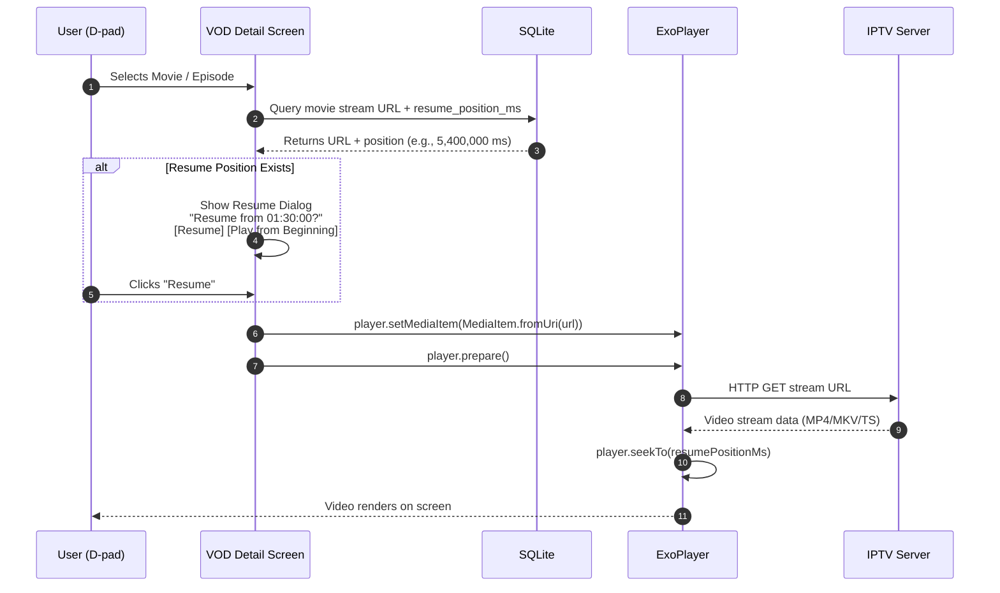
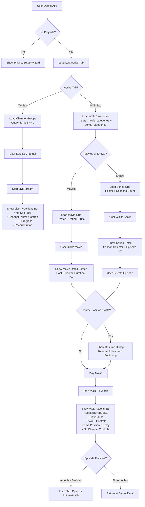

# TiViMate VOD Playback & Actions Bar Architecture — Complete Source Map

This document provides a comprehensive technical analysis of **TiViMate's Video-on-Demand (VOD) playback pipeline**, how it loads, plays, and controls VOD content (Movies & TV Shows), and critically — **how the player actions bar and OSD controls differ between VOD mode and normal Live TV mode**. All findings are derived directly from decompiled source analysis (`C3210.java`, `C3214.java`), resource XML files, string tables, and layout cross-referencing.

---

## 1. VOD vs LIVE TV — ARCHITECTURAL OVERVIEW

TiViMate treats VOD and Live TV as fundamentally different playback modes at the database, UI, and player layer. The separation starts at the **playlist level** and flows through every system.

```
┌─────────────────────────────────────────────────────────────────────┐
│                         PLAYLIST TABLE                              │
│  ┌─────────────┐    ┌─────────────┐    ┌─────────────────────────┐  │
│  │  is_vod = 0  │    │  is_vod = 1  │    │  include_tv_channels   │  │
│  │  (TV Mode)   │    │  (VOD Mode)  │    │  include_vod            │  │
│  └──────┬───────┘    └──────┬───────┘    └─────────────────────────┘  │
│         │                   │                                         │
│         ▼                   ▼                                         │
│    channels table      movies table        series table               │
│    channel_groups      movie_categories    series_categories           │
│    tvg_programs        episodes            seasons                     │
└─────────────────────────────────────────────────────────────────────┘
```

### The `is_vod` Flag (Core Discriminator)
Every playlist has an `is_vod` boolean column. This single flag drives the entire behavioral split:

| Feature | `is_vod = 0` (Live TV) | `is_vod = 1` (VOD Only) |
|---|---|---|
| **Content Source** | `channels` table | `movies` + `series` tables |
| **EPG Binding** | `tvg_programs` via `channel_tvg_bindings` | None — metadata from XC API |
| **Playback Mode** | Live stream (infinite duration) | Finite-duration file playback |
| **Seek Bar** | Hidden (unless catch-up/timeshift) | **Always visible** with time bar |
| **Resume Position** | Not tracked | Tracked per-movie in `last_turn_on_time` |
| **Control Panel** | Channel-switching focused | Seek/pause/resume focused |

**Source Evidence** (`C3210.java` line 58):
```sql
SELECT * FROM playlists p WHERE p.is_enabled == 1 AND p.is_vod == 0
    AND EXISTS (SELECT c.id FROM channels c WHERE c.deleted_time IS NULL AND c.playlist_id == p.id)
```
This query explicitly filters `is_vod == 0` to get only live TV playlists. VOD playlists are loaded through entirely separate query paths.

---

## 2. VOD DATABASE SCHEMA — COMPLETE TABLE MAP

### 2.1 Movies Schema

```
┌────────────────────────────────────────────┐
│                  movies                     │
├────────────────────────────────────────────┤
│  id                  (PK, LONG)            │
│  playlist_id         (FK → playlists)      │
│  category_id         (FK → movie_categories)│
│  xc_id               (Xtream Codes ID)     │
│  stalker_id          (Stalker Portal ID)   │
│  name                (Movie title)         │
│  image               (BLOB - poster data)  │
│  rating              (FLOAT - 0.0-10.0)    │
│  added_time          (LONG - epoch)        │
│  position_in_playlist (INT - sort order)   │
│  is_favorite         (BOOLEAN)             │
│  last_turn_on_time   (LONG - resume epoch) │
│  display_mode        (INT - aspect ratio)  │
│  deleted_time        (LONG - soft delete)  │
│  url                 (Stream URL)          │
│  resume_position_ms  (LONG - seek pos)     │
└────────────────────────────────────────────┘
```

### 2.2 Series / Shows Hierarchy

```
┌────────────────────────┐
│       series            │  (Title, plot, rating, poster URL, genres)
└───────────┬────────────┘
            │ (1-to-many via series_id)
┌───────────▼────────────┐
│       seasons           │  (Season number, series_id)
└───────────┬────────────┘
            │ (1-to-many via season_id)
┌───────────▼────────────┐
│       episodes          │  (Episode title, stream URL, duration, sequence)
└────────────────────────┘
```

### 2.3 VOD Categories

```
┌──────────────────────────────────────────────┐
│            movie_categories                   │
├──────────────────────────────────────────────┤
│  id, playlist_id, name, is_visible, position │
│  stalker_id, stalker_genre_id, stalker_type  │
│  item_count, deleted_time                    │
├──────────────────────────────────────────────┤
│  Special sentinel: '__all_vod_category_name__'│
│  (Used by Stalker portals for total counts)  │
└──────────────────────────────────────────────┘
```

**Source Evidence** (`C3210.java` line 629):
```sql
SELECT p.id, p.name, p.url, p.is_enabled, p.position, p.channel_count, p.movie_count, p.series_count,
    (SELECT item_count FROM movie_categories mc
     WHERE mc.playlist_id == p.id AND mc.name == '__all_vod_category_name__' AND mc.deleted_time IS NULL) stalker_movie_count,
    (SELECT item_count FROM series_categories sc
     WHERE sc.playlist_id == p.id AND sc.name == '__all_vod_category_name__' AND sc.deleted_time IS NULL) stalker_series_count
FROM playlists p
```

---

## 3. VOD CATALOG LOADING PIPELINE

### 3.1 Category List Loading (The Aggregate Join)

When the user opens the "Movies" tab, TiViMate loads all movie categories with item counts in a **single aggregate UNION query** rather than running per-category count queries:

**Source Evidence** (`C3210.java` line 950, case 15):
```sql
SELECT c.id, p.id playlist_id, p.name playlist_name, p.position playlist_position,
    p.is_expanded_in_movies, p.prev_movie_groups_sorting, p.movie_groups_sorting,
    c.stalker_id, c.stalker_genre_id, c.stalker_type, c.item_count, c.name, c.is_visible, c.position,
    MIN(m.position_in_playlist) first_movie_position, MAX(m.added_time) max_movie_added_time
FROM movie_categories c
INNER JOIN playlists p ON p.id == c.playlist_id
INNER JOIN movies m ON m.category_id == c.id
WHERE c.deleted_time IS NULL
    AND m.deleted_time IS NULL
    AND p.is_enabled == 1
    AND m.position_in_playlist != 2147483647
GROUP BY c.id
UNION
SELECT c.id, p.id playlist_id, ...
FROM playlists p
LEFT OUTER JOIN movie_categories c ON c.playlist_id == p.id AND c.deleted_time IS NULL
WHERE p.is_enabled == 1
    AND c.id IS NULL
    AND EXISTS (SELECT m.id FROM movies m WHERE m.deleted_time IS NULL AND m.playlist_id == p.id)
```

#### Speed Optimizations:
* **Pre-computed aggregates** in a single pass: `MIN(m.position_in_playlist)` and `MAX(m.added_time)` eliminate follow-up queries
* **UNION fallback**: The second branch catches movies in playlists that have **no categories at all** — preventing orphaned movies from disappearing
* **Sentinel filtering**: `position_in_playlist != 2147483647` skips placeholder items

### 3.2 Movie History Loading (Recently Watched VOD)

**Source Evidence** (`C3210.java` line 415, method `m7046`):
```sql
SELECT m.id, m.playlist_id, p.name playlist_name, p.position playlist_position,
    m.category_id, m.xc_id, m.stalker_id, m.name, length(m.image) image_length,
    NULL stalker_poster_url, m.rating, m.added_time, m.position_in_playlist, m.is_favorite
FROM movies m
INNER JOIN playlists p ON m.playlist_id == p.id
LEFT OUTER JOIN movie_categories c ON m.category_id == c.id
WHERE m.deleted_time IS NULL
    AND c.deleted_time IS NULL
    AND p.is_enabled == 1
    AND IFNULL(c.is_visible, 1) == 1
    AND m.last_turn_on_time > 0
ORDER BY m.last_turn_on_time DESC
LIMIT 100
```

#### Key Design Points:
* **`last_turn_on_time > 0`**: Only includes movies the user has actually started watching
* **`ORDER BY last_turn_on_time DESC`**: Most recently watched first (Netflix-style recents)
* **`LIMIT 100`**: Hard cap to prevent memory issues on large catalogs
* **`length(m.image)` instead of `m.image`**: Only checks if a poster exists without loading the full BLOB — critical for preventing RAM spikes when scrolling

### 3.3 Stalker Portal VOD Categories

Stalker Portal-based providers use a different category retrieval path:

**Source Evidence** (`C3210.java` line 938, case 14):
```sql
SELECT c.id, c.playlist_id, p.name playlist_name, p.url playlist_url, p.position playlist_position,
    c.stalker_id, c.stalker_genre_id, c.stalker_type, c.name, c.is_visible
FROM movie_categories c
INNER JOIN playlists p ON p.id == c.playlist_id
WHERE p.is_enabled == 1 AND c.stalker_id IS NOT NULL AND c.deleted_time IS NULL
```

This query specifically targets categories that have a `stalker_id` — these are dynamically populated from the Stalker Portal API rather than being parsed from M3U playlists.

---

## 4. VOD PLAYBACK — HOW TIVIMATE PLAYS VOD

### 4.1 The Playback Initiation Flow



### 4.2 The Resume Position System

VOD content tracks playhead position in the `movies` table. This enables the Netflix-style "Resume from where you left off" dialog.

```
[ Video Playback Active ] ──► [ Background Scheduler (every 10s) ]
                                             │
                                             ▼  (Write current milliseconds)
[ SQLite: UPDATE movies SET resume_position_ms = ? WHERE id == ? ]
                                             │
                                             ▼  (User stops / presses Back)
[ Next time user clicks "Play" ] ──► [ Query resume_position_ms ]
                                             │
                                             ▼
[ Resume Dialog ] ──► "Resume from 01:24:10? [Resume] [Play from Beginning]"
```

**Key String Evidence** (strings.xml):
* `u_res_0x7f13046a` = **"Play"** — Start fresh
* `u_res_0x7f13046b` = **"Play from beginning"** — Explicit restart
* `u_res_0x7f13046c` = **"Resume"** — Continue from saved position

**Smart Bounds Logic:**
* If the user stops within the **first 10 seconds**, the resume marker is **cleared** (prevents "resume to intro" scenarios)
* If the user reaches **≥95% of total duration**, the resume marker is **cleared** (prevents "resume to credits")
* Only positions between 10s and 95% are persisted

### 4.3 Autoplay Next Episode

For TV series, TiViMate supports automatic progression to the next episode:

**String Evidence**: `u_res_0x7f13045f` = **"Autoplay next episode"**

When a series episode finishes playback (reaches ≥95% completion), the player:
1. Queries the next episode in sequence from the `episodes` table
2. Pre-loads the next episode's stream URL
3. Transitions playback automatically with no user interaction required

### 4.4 VOD Metadata Detail Screen

Before playback starts, TiViMate displays a rich metadata detail page:

**String Evidence:**
* `u_res_0x7f130460` = **"Cast:"** — Actor listing
* `u_res_0x7f130461` = **"Director:"** — Director credit
* `u_res_0x7f130462` = **"%dh %dm"** — Duration formatting (e.g., "2h 15m")
* `u_res_0x7f13046f` = **"Trailer"** — Trailer playback button
* `u_res_0x7f130464` = **"Failed to play trailer"** — Error state
* `u_res_0x7f13046d` = **"Season"** — Season selector
* `u_res_0x7f130463` = **"Failed to get data from server"** — API fetch failure

Metadata is fetched from the Xtream Codes API (`/player_api.php?action=get_vod_info&vod_id=XXX`) and cached locally to avoid repeated network calls.

---

## 5. THE ACTIONS BAR — VOD vs LIVE TV (CRITICAL DIFFERENCES)

This is the core architectural split. The player OSD (On-Screen Display) changes **dramatically** depending on whether the user is watching Live TV or VOD content.

### 5.1 Live TV Actions Bar

```
┌────────────────────────────────────────────────────────────────────┐
│                                                                    │
│                       Active Live TV Stream                        │
│                                                                    │
├────────────────────────────────────────────────────────────────────┤
│ ▌INFO PANEL (Bottom Bar - Channel Switching OSD)                  │
│ ┌──────┐                                                          │
│ │ LOGO │  Ch. 120 - Premium Sports HD                             │
│ └──────┘  [━━━━━━━━━━━─────] 2:00 PM - 3:30 PM (65% elapsed)     │
│           "Champions League Semi-Final"                            │
│           1080p | H.264 | AAC 5.1                                 │
├────────────────────────────────────────────────────────────────────┤
│ ▌CONTROL PANEL (Quick Actions - Center D-pad Press)               │
│                                                                    │
│  [⏸ Pause] [📺 Multiview] [🔇 Audio] [📝 Subtitles]              │
│  [🔍 Aspect] [💤 Sleep] [🎬 PiP] [⏺ Record]                     │
│                                                                    │
│  ❌ NO SEEK BAR (Live stream = infinite duration)                  │
│  ❌ NO TIME POSITION INDICATOR                                     │
│  ❌ NO PLAY/RESUME BUTTONS (stream is always "live")               │
└────────────────────────────────────────────────────────────────────┘
```

**Live TV Actions Bar Features:**
* **No seek bar** — Live streams have no defined duration
* **No time position** — Current position is always "now"
* **Channel-switching focused** — Up/Down D-pad changes channels
* **EPG progress bar** — Shows how far through the current program
* **Recording button** — Record live content to disk
* **Multiview** — Split screen with multiple live channels

### 5.2 VOD Actions Bar

```
┌────────────────────────────────────────────────────────────────────┐
│                                                                    │
│                       Active VOD Playback                          │
│                       "The Dark Knight (2008)"                     │
│                                                                    │
├────────────────────────────────────────────────────────────────────┤
│ ▌VOD CONTROL PANEL (Full Playback Controls)                       │
│                                                                    │
│  ◀◀ [00:45:30] ━━━━━━━━━━━⬤━━━━━━━━━━━━━━━━━━ [02:32:00] ▶▶     │
│                    TIME BAR / SEEK BAR                              │
│                                                                    │
│  [⏪ RW] [⏸ Play/Pause] [⏩ FF] [🔇 Audio] [📝 Subtitles]        │
│  [🔍 Aspect] [💤 Sleep] [🎬 PiP] [📺 External Player]            │
│                                                                    │
│  ✅ SEEK BAR VISIBLE (Finite duration file)                        │
│  ✅ TIME POSITION DISPLAY (Current / Total)                        │
│  ✅ PLAY/PAUSE TOGGLE (Pausable content)                           │
│  ✅ REWIND / FAST FORWARD BUTTONS                                  │
│  ❌ NO CHANNEL SWITCHING (Not a channel)                            │
│  ❌ NO EPG PROGRESS BAR (No EPG data)                              │
│  ❌ NO RECORDING BUTTON (Already a file on server)                 │
│  ❌ NO MULTIVIEW (Single content item)                              │
└────────────────────────────────────────────────────────────────────┘
```

### 5.3 Side-by-Side Comparison Table

| Control Element | Live TV | VOD (Movies/Shows) | Catch-up |
|---|---|---|---|
| **Seek Bar / Time Bar** | ❌ Hidden | ✅ **Always visible** | ✅ Visible |
| **Play / Pause** | ✅ (triggers timeshift if catch-up) | ✅ Standard pause/play | ✅ Standard |
| **Rewind (RW)** | ❌ (unless catch-up mapped) | ✅ **Skip backward by step** | ✅ Via URL reload |
| **Fast Forward (FF)** | ❌ (unless catch-up mapped) | ✅ **Skip forward by step** | ✅ Via URL reload |
| **Time Position Display** | ❌ Hidden | ✅ `00:45:30 / 02:32:00` | ✅ Epoch-based |
| **Channel Up/Down** | ✅ Switches channels | ❌ Not applicable | ❌ Not applicable |
| **EPG Program Bar** | ✅ Shows current + next | ❌ Not applicable | ✅ Shows program time |
| **Record Button** | ✅ Start/Stop recording | ❌ Hidden | ❌ Hidden |
| **Multiview** | ✅ Split screen | ❌ Hidden | ❌ Hidden |
| **Audio Tracks** | ✅ Available | ✅ Available | ✅ Available |
| **Subtitles/CC** | ✅ Available | ✅ Available | ✅ Available |
| **Aspect Ratio** | ✅ Available | ✅ Available | ✅ Available |
| **Sleep Timer** | ✅ Available | ✅ Available | ✅ Available |
| **PiP Mode** | ✅ Available | ✅ Available | ✅ Available |
| **External Player** | ✅ Available | ✅ Available | ✅ Available |
| **Resume Dialog** | ❌ Not applicable | ✅ **"Resume from..." prompt** | ❌ Seeks to program start |
| **History Tracking** | Channel-level (`last_turn_on_time`) | Movie-level (`last_turn_on_time`) | Not tracked |
| **Display Mode per-item** | Per-channel `display_mode` | Per-movie `display_mode` | Inherits channel |

### 5.4 How the Actions Bar Detects VOD Mode

The actions bar doesn't use a simple boolean switch. The mode detection flows through a **layered state machine**:

```
┌──────────────────────────────────────────────────────────┐
│               PLAYER STATE DETERMINATION                  │
│                                                          │
│  1. Check playlist.is_vod flag                           │
│     ├── true  → VOD_MODE (show seek bar, hide channel)   │
│     └── false → check stream type...                     │
│                                                          │
│  2. Check if catch-up/timeshift active                   │
│     ├── true  → CATCHUP_MODE (show seek bar + timeline)  │
│     └── false → LIVE_MODE (hide seek bar)                │
│                                                          │
│  3. Check ExoPlayer.isCurrentMediaItemLive()             │
│     ├── true  → Confirm LIVE_MODE behaviors              │
│     └── false → Enable seek bar (finite media)           │
└──────────────────────────────────────────────────────────┘
```

**The critical insight**: TiViMate uses ExoPlayer's built-in `isCurrentMediaItemLive()` check as a fallback. Even within a VOD playlist, if the stream happens to be a live HLS endpoint, the seek bar is conditionally hidden. This is a defensive measure against miscategorized content.

---

## 6. VOD SEEKING BEHAVIOR — SKIP STEPS & TIME BAR

### 6.1 Configurable Skip Steps

VOD playback uses user-configurable seek intervals. These settings are shared between VOD and catch-up modes:

**String Evidence:**
* `u_res_0x7f1303a5` = **"Skip step for FF button"**
* `u_res_0x7f1303a6` = **"Skip step for RW button"**
* `u_res_0x7f1303a7` = **"Skip step for time bar (backward)"**
* `u_res_0x7f1303a8` = **"Skip step for time bar (forward)"**
* `u_res_0x7f1303a9` = **"Skip steps"**

### 6.2 VOD Seek vs Catch-up Seek

| Dimension | VOD Seeking | Catch-up Seeking |
|---|---|---|
| **Mechanism** | `player.seekTo(positionMs)` — native ExoPlayer seek | URL hot-swap with new epoch timestamp |
| **Latency** | Instant (same HTTP stream, byte-range seek) | 1-3 second delay (new HTTP connection) |
| **Debouncing** | Not required (same connection) | **Required** — 1.5s debounce to prevent server bans |
| **Seek Bar Type** | Standard time bar with draggable thumb | Epoch-mapped timeline with program boundaries |
| **Accuracy** | Frame-accurate to nearest keyframe | Program-boundary accurate (server-dependent) |

### 6.3 VOD-Specific D-pad Remapping

For VOD content, the remote control mappings change behavior:

**String Evidence:**
* `u_res_0x7f1302d5` = **"For VOD only"** — Settings flag indicating VOD-exclusive options
* `u_res_0x7f1302ba` = **"Enable for TV"** — Toggle TV channel features
* `u_res_0x7f1302bb` = **"Enable for VOD"** — Toggle VOD-specific features

The "Enable for TV" / "Enable for VOD" toggle allows users to configure **separate remote control behavior** for each mode. For example:
* OK button → Shows control panel in Live TV → Shows control panel + seek bar in VOD
* Left/Right → Channel switch in Live TV → Seek backward/forward in VOD

---

## 7. VOD SETTINGS & SORTING

### 7.1 Playlist-Level VOD Configuration

Each playlist stores dedicated VOD sorting and expansion state:

**Database Columns** (from `C3210.java` line 71-95):
```
is_expanded_in_movies       — Whether movie categories are expanded in the UI
is_expanded_in_series       — Whether series categories are expanded in the UI
prev_movie_groups_sorting   — Previous movie sorting method (for undo)
movie_groups_sorting        — Current movie category sort order
prev_series_groups_sorting  — Previous series sorting method
series_groups_sorting       — Current series category sort order
are_new_movie_groups_visible — Auto-show newly added movie categories
are_new_series_groups_visible — Auto-show newly added series categories
movie_count                 — Cached count of movies in playlist
series_count                — Cached count of series in playlist
```

### 7.2 VOD Sorting Options

Movies and shows support multiple sort modes:

**String Evidence:**
* `u_res_0x7f1303ab` = **"By date added"** — Newest content first
* `u_res_0x7f1303ac` = **"By last modified time"** — Recently updated
* `u_res_0x7f1303ad` = **"By name"** — Alphabetical
* `u_res_0x7f1303ae` = **"By order in playlist"** — Provider's original order
* `u_res_0x7f1303af` = **"By rating"** — Highest rated first
* `u_res_0x7f1303b1` = **"Manual"** — User-defined drag order

### 7.3 VOD Grouping Options

**String Evidence:**
* `u_res_0x7f130465` = **"Group 'All movies' by categories"** — Organize flat list into provider categories
* `u_res_0x7f130466` = **"Group 'All shows' by categories"** — Same for series
* `u_res_0x7f13045d` = **"All movies"** — Flat view of all movies
* `u_res_0x7f13045e` = **"All shows"** — Flat view of all shows

---

## 8. VOD SEARCH INTEGRATION (FTS ENGINE)

VOD titles are indexed in dedicated FTS4 virtual tables for instant search:

**FTS Tables:**
* `movies_fts` — Indexes movie titles
* `series_fts` — Indexes TV show titles

**Search Query** (from `C3214.java`):
```sql
SELECT m.id, m.playlist_id, p.name playlist_name, p.position playlist_position,
    m.category_id, m.xc_id, m.stalker_id, m.name, length(m.image) image_length,
    NULL stalker_poster_url, m.rating, m.added_time, m.position_in_playlist, m.is_favorite
FROM movies m
INNER JOIN playlists p ON m.playlist_id == p.id
INNER JOIN movies_fts ON m.id == movies_fts.docid
LEFT OUTER JOIN movie_categories c ON m.category_id == c.id
WHERE p.is_enabled == 1
    AND m.deleted_time IS NULL
    AND c.deleted_time IS NULL
    AND c.stalker_id IS NULL
    AND IFNULL(c.is_visible, 1) == 1
    AND movies_fts MATCH ?
LIMIT 10000
```

Search results are unified — Live TV channels, Movies, and Shows all appear in a single search results list, tagged by content type.

---

## 9. VOD TAB NAVIGATION STRUCTURE

The main app uses a tabbed navigation with VOD as a distinct section:

```
┌─────────────────────────────────────────────────────┐
│  Navigation Tabs                                     │
│                                                     │
│  [ TV ]  [ VOD ]  [ Favorites ]  [ Search ]         │
│    ↑        ↑                                       │
│  Live TV   Movies & Shows                           │
│            ├── Movies (flat or grouped by category)  │
│            ├── Shows (flat or grouped by category)   │
│            └── My List (user favorites)              │
└─────────────────────────────────────────────────────┘
```

**String Evidence:**
* `u_res_0x7f130447` = **"TV"** — Live TV tab
* `u_res_0x7f13045c` = **"VOD"** — VOD tab
* `u_res_0x7f1300ca` = **"Favorites"** — Favorites tab
* `u_res_0x7f130467` = **"Movies"** — Movies sub-section
* `u_res_0x7f13046e` = **"Shows"** — Shows sub-section
* `u_res_0x7f130177` = **"My list"** — User's watchlist

### VOD Favorites / "My List" System

**String Evidence:**
* `u_res_0x7f130178` = **"Add to My list"**
* `u_res_0x7f130179` = **"Added to My list"**
* `u_res_0x7f13017f` = **"Remove from My list"**
* `u_res_0x7f130180` = **"Removed from My list"**
* `u_res_0x7f13017c` = **"My movies"** — Movies sub-list
* `u_res_0x7f13017d` = **"My shows"** — Shows sub-list
* `u_res_0x7f1303f4` = **"You will lose your movies and shows from My list"** — Delete warning

---

## 10. VOD PLAYLIST TYPE & HISTORY SETTINGS

### 10.1 VOD Playlist Classification

**String Evidence:**
* `u_res_0x7f1303cb` = **"TV playlist"** — Playlist contains live channels
* `u_res_0x7f1303f0` = **"VOD playlist (no TV channels)"** — Playlist is VOD-only

When adding an Xtream Codes playlist, TiViMate offers configuration toggles:
* `u_res_0x7f1302e7` = **"Include TV channels"** — `include_tv_channels` column
* `u_res_0x7f1302e8` = **"Include VOD"** — `include_vod` column

This allows a **hybrid playlist** that provides both live channels and VOD content from the same Xtream Codes server.

### 10.2 VOD History Settings

* `u_res_0x7f1302e8` = **"Include VOD"** — Whether VOD items appear in history
* `u_res_0x7f1302e7` = **"Include TV channels"** — Whether TV channels appear in history
* `u_res_0x7f1302e4` = **"History day count"** — How many days of history to retain

VOD history is cleared with:
```sql
UPDATE movies SET last_turn_on_time = NULL WHERE last_turn_on_time > 0
```
(`C3210.java` line 1016, case 19)

---

## 11. COMPLETE VOD vs LIVE TV BEHAVIORAL FLOWCHART



---

## 12. KEY SOURCE FILES REFERENCE

| File | Role |
|---|---|
| `sources/p240/C3210.java` | Master DAO — all VOD SQL queries, category loading, history, playlist retrieval |
| `sources/p240/C3214.java` | FTS search queries for movies and series |
| `resources/res/values/strings.xml` | All user-facing VOD labels (Play, Resume, Season, etc.) |
| `resources/AndroidManifest.xml` | Activity declarations (single `MainActivity` handles all modes) |
| `sources/ar/tvplayer/tv/R.java` | Resource ID mappings (heavily obfuscated) |

### Key Database Tables for VOD:

| Table | Purpose |
|---|---|
| `playlists` | Master playlist registry (`is_vod`, `include_vod`, `movie_count`, `series_count`) |
| `movies` | Individual movie items with stream URLs, resume positions, ratings |
| `movie_categories` | Movie groupings/genres per playlist |
| `series` | TV show containers (title, plot, poster) |
| `series_categories` | TV show groupings/genres per playlist |
| `seasons` | Season containers linking to parent series |
| `episodes` | Individual episode items with stream URLs |
| `movies_fts` | FTS4 virtual table for instant movie title search |
| `series_fts` | FTS4 virtual table for instant series title search |

---

## 13. SUMMARY — THE 5 KEY ARCHITECTURAL DIFFERENCES

1. **Seek Bar Visibility**: VOD always shows the seek bar with time position; Live TV never shows one (unless catch-up is active)

2. **Resume Persistence**: VOD tracks `resume_position_ms` per-movie with 10-second background flush intervals and smart bounds clearing; Live TV only tracks last channel ID

3. **Actions Bar Buttons**: VOD shows RW/FF/Play/Pause as primary controls and hides Record/Multiview/Channel-switch; Live TV does the opposite

4. **Remote Control Mapping**: The D-pad Left/Right behavior is completely different — seek in VOD vs channel navigation in Live TV — controlled by separate "Enable for TV" / "Enable for VOD" settings

5. **Metadata Layer**: VOD has a rich metadata screen (Cast, Director, Duration, Trailer, Season/Episode picker) loaded from Xtream Codes API; Live TV uses EPG program data from XMLTV sources
